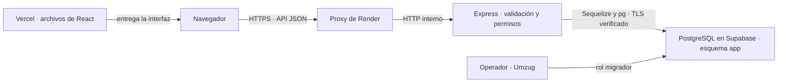

# Preparación técnica de Docker-laws para el Taller III

Material de estudio para la defensa grupal de Metodología de Sistemas II. Describe el código, los controles y las comprobaciones reproducibles de Docker-laws. La matriz de la sección 6 toma los requisitos prácticos de la primera página de la consigna oficial. Para la demostración se usan consultas y cuentas ficticias. [Consigna del Taller III](docs/Consigna_Taller_III_MSII_2026.pdf).

## 1. Introducción y arquitectura

Docker-laws es una aplicación para un estudio jurídico ficticio. Una persona puede enviar una consulta sin registrarse. El sistema permite crear una cuenta de cliente, iniciar y cerrar sesión. Los representantes habilitados pueden ver las consultas recibidas. Las dos entidades de negocio persistentes son la consulta y la cuenta de usuario.

El navegador ejecuta React y realiza peticiones HTTP con JSON a Express 5. El backend en TypeScript valida los datos, aplica las reglas de autorización y usa Sequelize 6 con el driver `pg` para acceder a PostgreSQL. Vite sirve la interfaz durante el desarrollo y genera los archivos estáticos para Vercel. La API desplegada se ejecuta en Render y usa PostgreSQL en Supabase. En local se puede demostrar el mismo flujo usando PostgreSQL 17.12 en Docker. [Configuración de Vite](frontend/vite.config.js) · [Arranque de Express](backend/index.ts) · [Conexión PostgreSQL](backend/database/connection.ts) · [Compose](docker-compose.yml).



| Componente | Qué hace | Dónde mostrarlo |
| --- | --- | --- |
| Interfaz | React Router ubica las vistas de inicio, envío, listado, login y registro. `AuthProvider` comparte el estado de la sesión con el menú y las vistas. | [App.jsx](frontend/src/App.jsx) · [AuthContext.jsx](frontend/src/context/AuthContext.jsx) |
| Cliente HTTP | Resuelve el origen de la API, construye peticiones, adjunta el token para las operaciones protegidas e interpreta errores y respuestas. | [apiConfig.js](frontend/src/config/apiConfig.js) · [formularioService.js](frontend/src/services/formularioService.js) · [authService.js](frontend/src/services/authService.js) |
| API | `createApp` ensambla CORS, lectura de JSON, rutas y manejo de errores. `iniciarServidor` valida el entorno, prepara los almacenes y abre la escucha. | [app.ts](backend/app.ts) · [index.ts](backend/index.ts) |
| Reglas y datos | Los controladores traducen el resultado a HTTP. Los validadores comprueban la entrada. El servicio de cuentas gestiona hashing, sesiones y permisos. Los almacenes ejecutan operaciones asíncronas sobre datos. | [Controlador de consultas](backend/controllers/formulario.controller.ts) · [Servicio de cuentas](backend/services/auth.service.ts) · [Almacén PostgreSQL](backend/data/formularios-postgres.ts) |
| Esquema e infraestructura | Umzug aplica migraciones explícitas. Compose prepara servicios, volúmenes y el montaje de archivos privados. | [Runner de migraciones](backend/database/migrate.ts) · [Compose de desarrollo](docker-compose.yml) · [Compose de pruebas](docker-compose.test.yml) |

`createApp` admite almacenes en memoria por instancia para las pruebas. El punto de entrada normal inyecta los almacenes PostgreSQL y las migraciones crean las tablas sin filas de negocio predefinidas. Esta separación permite probar el mismo contrato HTTP con datos controlados y aislar las verificaciones que dependen de una base real. [Contrato de consultas](backend/data/formularios-guardados.ts) · [Contrato de cuentas](backend/data/cuentas-guardadas.ts) · [Migraciones](backend/migrations/) · [Pruebas de aislamiento](backend/tests/app.test.ts).

## 2. Funcionamiento del sistema

### Enviar una consulta

1. `ConsultaJuridica.jsx` conserva los valores ingresados y muestra el estado pendiente al enviar. Deshabilita el botón durante la petición, anuncia el resultado y limpia los campos después de una confirmación válida. Ante un fallo, conserva la entrada para corregirla o volver a intentar. [Vista de consulta](frontend/src/pages/ConsultaJuridica.jsx).
2. `crearFormulario` envía `POST /formulario` con `Content-Type: application/json`. Espera `201` y un objeto con ID entero positivo y los siete textos. El servicio diferencia errores de validación, límite, red, configuración y respuesta incompatible. Los mensajes de servidor que se reproducen en pantalla pertenecen a una lista controlada. [Servicio HTTP de consultas](frontend/src/services/formularioService.js).
3. Express limita el cuerpo JSON a `100kb`, que equivale a 102400 bytes, y comprueba los bytes declarados como UTF-8. `validarFormulario` exige un objeto con `nombre`, `apellido`, `dni`, `telefono`, `email`, `asunto` y `mensaje` como textos no vacíos. Rechaza NUL, sustitutos Unicode aislados y correo con formato inválido. Conserva el texto válido y proyecta solo los campos aceptados. DNI y teléfono se tratan como texto. [Entrada HTTP](backend/app.ts) · [Validador](backend/validations/formulario.validation.ts).
4. El controlador espera `almacen.crear`. El adaptador limita la inserción a los siete campos y PostgreSQL genera el ID. La respuesta contiene el ID y los textos. Un `id` enviado desde el cliente queda fuera de la proyección. [Controlador](backend/controllers/formulario.controller.ts) · [Adaptador](backend/data/formularios-postgres.ts).

Si la red se interrumpe después de insertar, la interfaz puede perder la confirmación de una consulta ya guardada. El servicio evita reintentos automáticos y permite un nuevo envío manual. Es un límite importante al explicar un fallo de red. [Servicio HTTP de consultas](frontend/src/services/formularioService.js) · [Vista de consulta](frontend/src/pages/ConsultaJuridica.jsx).

### Registrar una cuenta e iniciar sesión

`POST /auth/register` acepta nombre, correo y contraseña. Recorta los bordes del nombre y del correo y valida el formato. La contraseña exige un mínimo de ocho caracteres según la comprobación de longitud y un máximo de 72 bytes UTF-8. El alta pública crea un `cliente`. El tipo se puede omitir o indicar como `cliente`. Un intento de alta pública como `representante` recibe `400`. El servicio guarda un hash bcrypt de costo 10 y devuelve el perfil público. Un correo repetido recibe `409` y la restricción `UNIQUE(email)` protege también la integridad en PostgreSQL. [Validador de cuentas](backend/validations/auth.validation.ts) · [Servicio de autenticación](backend/services/auth.service.ts) · [Modelo de usuario](backend/models/usuario.model.ts) · [Almacén de cuentas](backend/data/cuentas-postgres.ts).

`POST /auth/login` valida credenciales y compara el hash con bcrypt. Un correo desconocido también pasa por bcrypt contra un hash sintético. En ambos casos de credenciales incorrectas se devuelve el mismo `401`. El éxito devuelve un token opaco y un perfil con `puedeLeerConsultas` y `expiraEn`. En React, el registro intenta iniciar sesión después de crear la cuenta. Si la segunda operación falla, la pantalla informa que el alta ya se completó y ofrece el acceso por login. [Controlador de cuentas](backend/controllers/auth.controller.ts) · [Servicio de autenticación](backend/services/auth.service.ts) · [Registro en React](frontend/src/pages/Register.jsx).

El token permanece en `sessionStorage` y se envía en el encabezado `Authorization` con el esquema `Bearer`. La API conserva las sesiones en memoria por proceso, con ocho horas de vigencia, hasta tres sesiones por cuenta y 256 en total. Al iniciar una cuarta sesión de la misma cuenta se revoca la más antigua. Si hace falta una plaza y el cupo global está lleno, login devuelve `503`. Un reinicio invalida las sesiones y conserva las cuentas y consultas de PostgreSQL. `GET /auth/me` permite recuperar el perfil al recargar. `POST /auth/logout` revoca el token presentado y responde `204`. La interfaz borra el token local primero y avisa si el servidor no confirmó la revocación. [Servicio de sesiones](backend/services/auth.service.ts) · [Cliente de autenticación](frontend/src/services/authService.js) · [Contexto de sesión](frontend/src/context/AuthContext.jsx).

### Habilitar representantes y leer consultas

La CLI `crear-representante.ts` toma nombre, correo y contraseña de un JSON privado, usa las mismas validaciones y el rol SQL de aplicación, y devuelve el ID creado con tipo `representante`. Admite PostgreSQL local por loopback literal y el perfil `supabase-dev` con confirmación explícita `--supabase-project REF`. El operador habilita el ID por separado en `AUTH_REPRESENTANTES_IDS`. La lista pertenece a la base que contiene esas cuentas. Una lista ausente o vacía concede cero permisos y una lista inválida impide el arranque. [CLI administrativa](backend/scripts/crear-representante.ts) · [Configuración de IDs](backend/config/app.config.ts) · [Alta local en la demostración](#mostrar-el-comportamiento).

El permiso exige **sesión vigente, tipo representante e ID habilitado**. `GET /formulario` y `GET /formulario/:id` comprueban transporte y permiso antes de invocar el controlador de consultas. Un cliente cuyo ID esté en la lista sigue recibiendo `403`. El correo declarado en una consulta tampoco concede permisos. La política permite al representante habilitado ver toda la colección ficticia, sin asignación de consultas por usuario. [Guardia de sesión](backend/middleware/sesion.middleware.ts) · [Rutas de formularios](backend/routes/formulario.routes.ts) · [Pruebas HTTP de autorización](backend/tests/auth.http.test.ts).

React muestra el acceso a «Consultas recibidas» según el permiso del perfil. La vista carga el listado al recibir el permiso, distingue carga, error y colección vacía y descarta respuestas si cambia el token o se desmonta. Un `401` de lectura retira la sesión y un `403` retira el permiso de lectura de la vista. La API de detalle existe y se prueba por separado. La pantalla actual muestra los datos de las consultas en tarjetas a partir del listado. [Menú](frontend/src/components/layout/Navbar.jsx) · [Vista de listado](frontend/src/pages/ConsultasRecibidas.jsx) · [Contexto de sesión](frontend/src/context/AuthContext.jsx).

### Contratos HTTP, errores y límites

| Operación | Resultado esperado | Rechazos principales |
| --- | --- | --- |
| `GET /health` | `200` y `{"status":"ok"}`. Comprueba respuesta del proceso. | La disponibilidad de PostgreSQL se comprueba al arrancar y en las operaciones que lo usan. |
| `POST /formulario` | `201` con el objeto creado. Envío público. | `400` por entrada inválida, `413` por exceso del cuerpo, `415` si el parser rechaza el formato y `429` al exceder su límite. |
| `GET /formulario` | `200` con una lista ordenada por ID. `[]` representa ausencia de consultas. | `401` sin sesión válida, `403` sin permiso o sin transporte exigido. |
| `GET /formulario/:id` | `200` con un objeto. El controlador convierte el parámetro con `Number`. | `401` o `403` antes de buscar, `404` cuando un representante autorizado pide un ID inválido para el almacenamiento o inexistente. |
| `POST /auth/register`, `POST /auth/login` | `201` con el perfil del cliente o `200` con la sesión iniciada. | `400` por validación, `409` por duplicado en registro, `401` por credenciales inválidas, `429` por el límite de peticiones, `503` por falta de cupo de sesión. |
| `GET /auth/me`, `POST /auth/logout` | `200` con el perfil vigente o `204` sin cuerpo tras cerrar. El cierre es idempotente. | `401` al solicitar un perfil sin sesión válida. Las rutas de cuentas también están sujetas al requisito de HTTPS en producción y Render. |

Los errores previstos se contestan con un objeto `{ message }`. El middleware final convierte fallos internos, como una consulta rechazada por el almacén, en `500` con un mensaje genérico. CORS autoriza al navegador a leer respuestas según el origen configurado. Las peticiones directas a la API se autorizan por sesión y permiso. Las respuestas de cuentas y lecturas protegidas usan `Cache-Control: no-store`. [Middleware de errores](backend/middleware/error.middleware.ts) · [Configuración CORS y de proxies](backend/config/app.config.ts) · [Pruebas HTTP](backend/tests/formulario.http.test.ts).

Los tres límites de escritura y acceso se aplican por ruta durante diez minutos, por IP y por proceso. Registro permite 5 por IP y 40 en total. Login permite 10 y 120. Envío de consultas permite 20 y 120. `429` incluye `Retry-After`. La IP efectiva depende de la configuración del proxy. [Limitador](backend/middleware/limite-solicitudes.middleware.ts) · [Rutas de cuentas](backend/routes/auth.routes.ts) · [Rutas de formularios](backend/routes/formulario.routes.ts).

### Persistencia y migraciones

| Objeto en el esquema `app` | Contenido y restricciones |
| --- | --- |
| `consultas` | PK `id INTEGER` generada mediante secuencia. Siete campos `TEXT NOT NULL`. Los datos de contacto son los declarados en esa consulta. |
| `usuarios` | PK `id INTEGER` generada mediante secuencia. `nombre`, `email`, `tipo` y `password_hash` son textos obligatorios. `UNIQUE(email)` y `CHECK` restringen el correo duplicado y los tipos de cuenta. |
| `"SequelizeMeta"` | Nombres de las migraciones aplicadas. Es historial de Umzug y pertenece al ámbito del rol migrador. |

Cada tabla de negocio tiene su propio ID, sin relación de pertenencia entre cuenta y consulta. Los modelos desactivan `timestamps`. `001-crear-consultas` y `002-crear-usuarios` definen el DDL versionado. Cada migración crea su objeto y concede permisos dentro de una transacción. Umzug registra después el éxito. Ante una interrupción entre ambos pasos, se suspenden los reintentos y se contrastan los objetos físicos y `app."SequelizeMeta"` con consultas de solo lectura. La CLI admite `up` y `status` local. En Supabase solo admite `up` con la referencia explícita, porque `status` puede inicializar el historial. [Migración de consultas](backend/migrations/001-crear-consultas.ts) · [Migración de usuarios](backend/migrations/002-crear-usuarios.ts) · [Runner Umzug](backend/database/migrate.ts).

Al inicializar un volumen local vacío, PostgreSQL crea la base, los roles y el esquema `app`. El migrador es dueño del esquema. La aplicación recibe `USAGE` del esquema, `SELECT` y `INSERT` sobre las tablas de negocio y `USAGE` sobre sus secuencias. El diseño reserva el DDL y el historial al migrador. El inicio de Express verifica la conexión, la forma del esquema y los permisos necesarios antes de escuchar. Usa el rol de aplicación y falla si el esquema es incompatible, falta una migración o la base no está disponible. [Inicializador local](docker/postgres/inicializar.sh) · [Adaptador de consultas](backend/data/formularios-postgres.ts) · [Adaptador de cuentas](backend/data/cuentas-postgres.ts) · [Punto de entrada](backend/index.ts).

## 3. Estrategia y ejecución del testing

### Qué ejecuta cada conjunto

- **Backend sin base externa.** `node:test`, `assert/strict` y `tsx` ejecutan las pruebas de TypeScript. Los validadores y almacenamientos en memoria se prueban directamente. Las pruebas HTTP montan Express y usan `fetch` contra `127.0.0.1` en un puerto efímero. Se inyectan almacenes aislados, promesas controladas o fallos para comprobar la respuesta del controlador y que las solicitudes rechazadas no generen efectos. Cerrar el servidor forma parte del helper. [Scripts del backend](backend/package.json) · [Helper HTTP](backend/tests/helpers/http.ts).
- **Frontend.** Vitest ejecuta JavaScript y JSX con jsdom. Testing Library usa roles, etiquetas, teclado y eventos de usuario. Se controla `fetch` y en algunos casos el tiempo. Se ejecutan componentes, navegación, estado de sesión y servicios reales del frontend. El setup restablece DOM, mocks, entorno, historial y `sessionStorage` entre pruebas. [Configuración](frontend/vite.config.js) · [Setup de pruebas](frontend/src/test/setup.js).
- **PostgreSQL real.** `test:postgres` inicia dos entornos descartables, uno por archivo. Ejecuta Umzug, Sequelize, PostgreSQL y la API real donde corresponde, con claves sintéticas, puerto de loopback, volumen y proyecto Docker propios. Comprueba esquema, roles, historial, datos previos, persistencia, fallos y permisos SQL. [Runner de migraciones y API](scripts/verificar-migraciones.mjs) · [Aislamiento de PostgreSQL](scripts/postgres.mjs) · [Guardas de pruebas](backend/tests/helpers/postgres.ts).
- **Infraestructura.** Los tests de PostgreSQL ejercitan selección de entorno, configuración, propiedad de recursos y límites de limpieza. Los del verificador Docker combinan archivos sintéticos con ensayos de Docker y Buildx reales. El control público debe permanecer y los marcadores ficticios de archivos sensibles deben faltar. Los casos de fuga deliberada comprueban que el verificador también falla cuando corresponde. [Protecciones del runner](scripts/postgres.test.mjs) · [Pruebas Docker](scripts/verificar-docker.test.mjs).

El recorrido React de `App.test.jsx` envía y muestra la misma consulta con la red controlada. Sirve para probar la integración de la interfaz, sus servicios y el contrato simulado. La suite con PostgreSQL cubre el recorrido real **HTTP a base**, sin una interfaz de navegador. La comprobación completa **navegador, API y base** se puede demostrar manualmente con la secuencia de la sección 7. El repositorio contiene estos niveles y carece de una suite de navegador automatizada que levante el stack completo. [Recorrido en jsdom](frontend/src/App.test.jsx) · [API y PostgreSQL](backend/tests/formulario.postgres.test.ts).

### Inventario de archivos de prueba

| Archivo | Evidencia que aporta |
| --- | --- |
| [formulario.validation.test.ts](backend/tests/formulario.validation.test.ts) · [formularios-guardados.test.ts](backend/tests/formularios-guardados.test.ts) | Validación por campo, proyección, preservación del texto, ID en memoria, copias defensivas y aislamiento. |
| [formulario.http.test.ts](backend/tests/formulario.http.test.ts) | Creación, listado y detalle, espera de operaciones asíncronas, CORS, entradas inválidas, límites y fallos sin mutación. |
| [app.test.ts](backend/tests/app.test.ts) · [app.config.test.ts](backend/tests/app.config.test.ts) | Importación sin arranque, apps independientes, configuración de orígenes, puerto, proxies e IDs, arranque que falla de forma segura. |
| [auth.http.test.ts](backend/tests/auth.http.test.ts) · [auth.seguridad.test.ts](backend/tests/auth.seguridad.test.ts) | Alta, login, duplicados, credenciales, permisos, revocación, expiración, TTL, cupos, límites, TLS directo y proxy local. |
| [database.test.ts](backend/tests/database.test.ts) · [database.supabase.test.ts](backend/tests/database.supabase.test.ts) | Perfiles PostgreSQL, credenciales por rol, configuración TLS, conexión TLS real en loopback con CA sintética y barreras de la CLI. |
| [typecheck.test.ts](backend/tests/typecheck.test.ts) | Comando y perfil efectivo de TypeScript, inventario de fuentes y fallo `TS2322` introducido en una copia temporal. |
| [database.integration.test.ts](backend/tests/database.integration.test.ts) · [formulario.postgres.test.ts](backend/tests/formulario.postgres.test.ts) | PostgreSQL real. Migraciones y restricciones, preservación al aplicar `002`, permisos, API, concurrencia, cierre y persistencia. |
| [App.test.jsx](frontend/src/App.test.jsx) · [App.auth.test.jsx](frontend/src/App.auth.test.jsx) | Navegación y envío, autenticación, restauración, expiración, salida, respuestas tardías y vistas restringidas. |
| [ConsultaJuridica.test.jsx](frontend/src/pages/ConsultaJuridica.test.jsx) · [ConsultasRecibidas.test.jsx](frontend/src/pages/ConsultasRecibidas.test.jsx) | Formularios accesibles por etiquetas, tabulación, envío pendiente, conservación de campos y estados del listado. |
| [formularioService.test.js](frontend/src/services/formularioService.test.js) · [apiConfig.test.js](frontend/src/config/apiConfig.test.js) | Contratos de servicios, estados HTTP, mensajes seguros, forma de las respuestas y URL de la API. |
| [postgres.test.mjs](scripts/postgres.test.mjs) · [verificar-docker.test.mjs](scripts/verificar-docker.test.mjs) | Guardas de entornos y limpieza. Argumentos, exclusión de archivos, formatos Docker y OCI, y detección de marcadores en configuración y capas. |

### Casos para explicar con el código abierto

| Tipo y objetivo | Entrada o preparación | Resultado esperado y por qué importa | Test |
| --- | --- | --- | --- |
| Normal · creación y lectura | Consulta de siete campos con `id` y una propiedad extra. Peticiones posteriores de listado y detalle con sesión de prueba. | `201` con ID generado y campos públicos. El listado y el detalle recuperan el mismo objeto. Verifica el contrato completo sin permitir que el cliente elija el ID. | [HTTP de consultas](backend/tests/formulario.http.test.ts#L11) |
| Límite · tamaño JSON | Cuerpos de 102400 y 102401 bytes. | El primero se admite y el segundo recibe `413` sin modificar los registros. Comprueba el borde real del parser usando bytes. | [Límite exacto HTTP](backend/tests/formulario.http.test.ts#L173) |
| Error · caracteres inválidos | NUL y sustitutos aislados en cada campo, además del control HTTP de bytes UTF-8 inválidos. | `400` antes de almacenar. Los textos Unicode válidos se conservan. Evita guardar entradas que no representan el texto recibido o que PostgreSQL rechazaría. | [Validador de texto](backend/tests/formulario.validation.test.ts#L37) · [UTF-8 HTTP](backend/tests/formulario.http.test.ts#L148) · [Verificación con PostgreSQL](backend/tests/formulario.postgres.test.ts#L195) |
| Límite · credencial en bytes | Contraseñas ASCII y multibyte de 72 y 73 bytes en registro y login. | Se admite 72 bytes. El caso de 73 se rechaza antes de usar el almacén. Protege el límite de bcrypt también con caracteres multibyte. | [Límite bcrypt](backend/tests/auth.http.test.ts#L158) |
| Error · acceso de cliente | Sesión de cliente con ID en la lista o correo coincidente con una consulta. | `403` y ausencia de acceso al almacén de consultas. Demuestra que ninguna coincidencia sustituye al rol y a la habilitación. | [Autorización de cliente](backend/tests/auth.http.test.ts#L275) |
| Normal y límite · sesión | Login de representante habilitado y uso del token al vencer o después de logout. | Con sesión válida puede leer la colección. Después del vencimiento o la revocación recibe `401`. Distingue permiso de vigencia. | [Lectura permitida](backend/tests/auth.http.test.ts#L317) · [Revocación](backend/tests/auth.http.test.ts#L342) |
| Normal y error · transporte | Un proxy TLS local reenvía por HTTP y fija el protocolo. Se prueba además HTTP sin protocolo válido y un origen ajeno a un CIDR explícito. | El login reenviado válido devuelve `200`. HTTP directo sin indicación válida, valores ambiguos y encabezados de un origen excluido reciben `403` en los casos ensayados. La prueba permite discutir la confianza del último salto. | [TLS y proxies](backend/tests/auth.seguridad.test.ts#L150) |
| Límite · actualización de esquema | Base descartable con solo `001` y una consulta ficticia. Ejecutar `002` desde el runner. | El arranque exige la tabla de cuentas. Aplicar la migración de usuarios conserva ID y contenido de la consulta y deja el historial consistente. Verifica integración sobre datos previos. | [Actualización de la base](backend/tests/database.integration.test.ts#L75) |
| Error · fallo persistente | Conexión PostgreSQL cerrada durante el uso. | Crear, listar y buscar devuelven `500` seguro. Hace observable el fallo real de la base ya que un respaldo en memoria podría responder con datos distintos. | [Conexión cerrada](backend/tests/formulario.postgres.test.ts#L253) |
| Normal y error · interfaz | Mantener pendiente un envío y resolverlo con `201`. En otro caso responder con `400` y reintentar corregido. | Se hace un solo envío mientras espera. La UI solo limpia con éxito y conserva los datos ante fallo. Garantiza que el aviso refleje el resultado. | [Pruebas del formulario React](frontend/src/pages/ConsultaJuridica.test.jsx#L32) |
| Error · cambio de sesión | Respuesta de listado demorada hasta después de cerrar sesión. | React descarta la respuesta y las consultas quedan ocultas. Evita volver a mostrar datos de una sesión revocada localmente. | [Respuesta tardía](frontend/src/App.auth.test.jsx#L220) |
| Error · identidad TLS | Servidor local con CA sintética. Repetir con CA ajena y nombre de servidor incorrecto. | Solo se completa el handshake con CA y nombre correctos. Demuestra las comprobaciones del cliente sin consultar Supabase. | [TLS real en loopback](backend/tests/database.supabase.test.ts#L143) |
| Error · secreto en una capa | Imagen de prueba con un marcador ficticio copiado y borrado en una capa posterior. | El verificador detecta el marcador porque inspecciona capas. Revisar solo el árbol final ocultaría el problema. | [Fuga sintética en capas](scripts/verificar-docker.test.mjs#L243) |

### Ejecutar e interpretar

Desde la raíz, con las dependencias de cada proyecto instaladas mediante su lockfile:

```powershell
pnpm --dir backend run test
pnpm --dir backend run typecheck
pnpm --dir frontend run test
pnpm --dir frontend run lint
pnpm --dir frontend run build
```

Con Docker local activo, Buildx y `tar` compatible para la revisión de imágenes:

```powershell
node --test scripts/postgres.test.mjs scripts/verificar-docker.test.mjs
pnpm --dir backend run test:postgres --limpiar
node scripts/verificar-docker.mjs --modo contexto
node scripts/verificar-docker.mjs --modo imagenes
```

Para abrir un archivo de pruebas concreto sin lanzar los demás se puede usar, por ejemplo, `pnpm --dir backend exec node --import tsx --test tests/auth.http.test.ts`. Un fallo de prueba identifica el comportamiento y la aserción que difieren. Revisá primero el código HTTP, el cuerpo y el estado del almacén, o, en las pruebas de interfaz, el evento y el estado visible. Los contadores de `node:test` incluyen padres en suites con subpruebas. Para comunicar casos de PostgreSQL, distinguí los 25 casos hoja de las dos entradas contenedoras que también aparecen en TAP.

El runner PostgreSQL elimina del entorno los parámetros heredados de otros destinos, exige un Docker local y comprueba las etiquetas, nombres y montajes antes de limpiar sus recursos nuevos. `--limpiar` debe usarse con ese runner, no sobre volúmenes compartidos. Las pruebas con DDL arrancan con un esquema descartable y el conjunto normal no requiere Docker ni una base externa. Algunas pruebas normales sí abren HTTP o TLS en loopback. El comando agrupado de infraestructura contiene pruebas con Docker real. [Runner PostgreSQL](scripts/postgres.mjs) · [CLI de verificación de migraciones](scripts/verificar-migraciones.mjs) · [Verificador Docker](scripts/verificar-docker.mjs).

**Comprobación del código relevado.** En una copia temporal con Node 22.23.4 y pnpm 12.3.4 pasaron 359 pruebas del backend, 108 casos en los seis archivos de frontend, 25 casos hoja con PostgreSQL y 65 pruebas de infraestructura. Pasaron el typecheck, lint, los builds frontend normal y Vercel con una API ficticia, la validación de ambos Compose y el filtrado de ambos contextos Docker. No se midió cobertura, no se reconstruyeron ambas imágenes completas de aplicación en esta comprobación y no se ejercitaron los servicios desplegados. Estos resultados sirven para interpretar la ejecución, sin convertir las cantidades en requisitos.

## 4. Herramientas y evidencias de calidad

| Aspecto | Qué demostrar en el repositorio |
| --- | --- |
| Tipos efectivos | `tsc --noEmit -p tsconfig.json` comprueba fuentes, pruebas y helpers con `strict` y `skipLibCheck: false`. La prueba consulta la configuración y el inventario efectivos, espera `TS2322` para un error deliberado en una copia y verifica que los originales conserven sus huellas. [Configuración](backend/tsconfig.json) · [Prueba de tipos](backend/tests/typecheck.test.ts#L39) |
| Responsabilidades observables | `index.ts` abre recursos y `app.ts` ensambla la aplicación. Los controladores no necesitan conocer Sequelize. Los validadores convierten la entrada desconocida en objetos válidos. El adaptador en memoria permite comprobar el mismo contrato en una app aislada. [Arranque](backend/index.ts) · [Controlador](backend/controllers/formulario.controller.ts) · [Decisiones de diseño](docs/decisiones-diseno.md) |
| Límites de datos y de errores | Mostrar la proyección de los siete campos, la proyección del perfil sin hash, el `400` ante texto inválido, el `413` al superar el cuerpo y el `500` que oculta un fallo interno. Hay capas reales distintas de defensa, desde validación hasta restricciones SQL. [Formulario](backend/validations/formulario.validation.ts) · [Perfil público](backend/models/usuario.model.ts) · [Middleware de errores](backend/middleware/error.middleware.ts) · [DDL de usuarios](backend/migrations/002-crear-usuarios.ts) |
| Revisión estática de React | ESLint incluye reglas recomendadas de JavaScript, Hooks y React Refresh para archivos JS/JSX. El build de Vite verifica la construcción del bundle. En modo Vercel también exige el origen HTTPS de la API. [ESLint](frontend/eslint.config.js) · [Vite](frontend/vite.config.js) |
| Privilegios y operación segura | Los roles SQL separan ejecución y migraciones. Los perfiles local y Supabase tienen guardas de destino. Las exclusiones cubren rutas y patrones de archivos privados. El verificador ensaya esas categorías con marcadores sintéticos y conserva archivos públicos de control. Se puede mostrar toda la comprobación sin acceder a las claves reales. [Configuración PostgreSQL](backend/config/database.config.ts) · [Exclusiones Git](.gitignore) · [Exclusiones backend](backend/.dockerignore) · [Exclusiones frontend](frontend/.dockerignore) · [Verificador](scripts/verificar-docker.mjs) |
| Accesibilidad verificable | Los siete controles tienen etiquetas vinculadas y navegación por teclado. El estado pendiente y la confirmación se anuncian en una región `status` y el error usa `alert`. Las pruebas comprueban las relaciones y el comportamiento en jsdom. La revisión humana del prototipo de consultas fue confirmada por el usuario con Chrome y Narrador en Windows 10. Esa evidencia se limita al recorrido revisado y las pruebas de cuentas se ejecutan en jsdom. [Formulario y estados](frontend/src/pages/ConsultaJuridica.jsx) · [Pruebas de interfaz](frontend/src/pages/ConsultaJuridica.test.jsx#L16) · [Evidencia manual](docs/decisiones-diseno.md#5-errores-útiles-y-formulario-accesible) |

### Evidencias para mostrar durante la defensa

- **Aislar el arranque.** Abrir el puerto o la base al importar la aplicación dificultaría ejecutar pruebas independientes. `createApp` ensambla Express con almacenes inyectables y `index.ts` administra escucha y conexión. Así se puede comprobar la API con un almacén aislado. Los tests importan y preparan la app en procesos hijos que terminan sin abrir escucha ni conectarse a PostgreSQL. [Aplicación](backend/app.ts) · [Arranque](backend/index.ts) · [Pruebas de importación](backend/tests/app.test.ts#L64).
- **Rechazar entradas sin efectos secundarios.** Los cuerpos excesivos consumen recursos y una excepción del almacén puede contener detalles internos. El límite de JSON se aplica antes de escribir y el middleware central transforma el fallo interno en un `500` genérico. Las pruebas comparan `102400` con `102401` bytes, comprueban que el rechazo no cambia los registros y comprueban el mensaje ante un fallo del almacén. [Límite de JSON](backend/app.ts) · [Errores](backend/middleware/error.middleware.ts) · [Pruebas de límite y error](backend/tests/formulario.http.test.ts#L173).
- **Autorizar antes de leer.** Una petición puede llegar a la API sin pasar por el menú de React. Express exige sesión vigente, tipo representante e ID habilitado antes de llamar al almacén de consultas. Esto protege listado y detalle incluso si coincide el correo o se incluyó por error el ID de un cliente. El test comprueba `403` y que el almacén de consultas no se invoca. [Rutas](backend/routes/formulario.routes.ts) · [Autorización](backend/middleware/sesion.middleware.ts) · [Prueba de acceso directo](backend/tests/auth.http.test.ts#L275).

El build valida que la aplicación se pueda empaquetar. El resultado medido incluye una imagen de la vista de inicio de aproximadamente 25 MB. El tamaño del recurso es una limitación observable que conviene distinguir de la corrección funcional y de los resultados de pruebas. [Uso de la imagen en inicio](frontend/src/pages/Home.jsx).

## 5. Despliegue y automatización

| Entorno | Cómo se ejecuta Docker-laws |
| --- | --- |
| Host local | Vite sirve React en `localhost:5173`. Express escucha en `3001` por defecto. PostgreSQL en Docker se alcanza en `127.0.0.1:5433`. Se aplican las migraciones antes de iniciar Express. [Ejecución local](README.md#frontend-y-backend-en-el-host-con-postgresql-en-docker) |
| Compose | Los Dockerfiles usan Node 22 y pnpm con lockfile. El frontend ejecuta Vite y el backend ejecuta TypeScript con `tsx`. Express conecta con `postgres:5432` por la red de Compose. Los puertos publicados son locales, PostgreSQL tiene healthcheck y volumen nombrado, y el backend recibe la clave de aplicación mediante un secreto montado. [Compose](docker-compose.yml) · [Dockerfile backend](backend/Dockerfile) · [Dockerfile frontend](frontend/Dockerfile) |
| Vercel | El equipo informa que el frontend se despliega desde el fork `HomeroColomboArg/MetodologiaDeSistemasII`, rama `main`. La configuración versionada en `frontend/vercel.json` declara instalación con lockfile, build en modo `vercel` y salida `dist`. Reescribe `/login`, `/register`, `/consulta-juridica` y `/consultas` a `index.html` para que React resuelva la navegación. El navegador llama a la API por HTTPS. [Configuración versionada](frontend/vercel.json) |
| Render | El equipo informa que el backend se despliega desde `nicc-essp/MetodologiaDeSistemasII`, rama `main`, con Node.js 24.22.1, instalación `pnpm install --frozen-lockfile` e inicio `pnpm start`. El manifiesto de `backend` define `start` para ejecutar `index.ts` mediante `tsx`. El código escucha en `0.0.0.0` y usa `PORT`, expone `/health` y cierra la escucha y el pool al apagar el proceso. [Manifiesto](backend/package.json) · [Arranque](backend/index.ts) · [Ruta de salud](backend/routes/health.routes.ts) |
| Supabase | El equipo informa que la base desplegada es PostgreSQL en Supabase. El perfil de código usa el esquema `app` y admite conexión directa o Session pooler por `5432`. En modo `session`, el usuario de transporte agrega la referencia del proyecto y el rol validado en SQL sigue siendo `docker_laws_app`. [Perfiles](backend/config/database.config.ts) |

### Variables y límites de confianza

| Configuración | Función |
| --- | --- |
| `VITE_API_BASE_URL` | Dirección pública de la API. Vite la incorpora al build. El build Vercel exige un origen HTTPS con nombre DNS y sin credenciales, ruta, consulta ni fragmento. El cliente local admite una base HTTP(S) con prefijo y, si falta, usa `http://localhost:3001`. |
| `CORS_ORIGINS`, `PORT` | Orígenes de navegador admitidos y puerto de escucha. En Render se exige una lista de orígenes HTTPS explícita. La autorización de lecturas se verifica en Express. |
| `AUTH_REPRESENTANTES_IDS` | IDs positivos de representantes habilitados de la base de demostración. Se valida al arrancar antes de abrir PostgreSQL. |
| `RENDER`, `NODE_ENV`, `TRUST_PROXY_CIDRS` | Render y el modo producción activan la exigencia de HTTPS para cuentas y lecturas. Una lista de IP/CIDR explícita tiene prioridad. Con `RENDER=true` y lista vacía se aplica `trust proxy = 1`. Fuera de Render, una lista vacía mantiene la confianza desactivada. |
| `POSTGRES_TARGET`, `POSTGRES_HOST`, `POSTGRES_PORT`, `POSTGRES_DB` | Seleccionan destino y coordenadas de conexión. Compose fuerza `local`. Render exige `supabase-dev` explícito. En remoto, el código exige `POSTGRES_PORT=5432` y `POSTGRES_DB=postgres`. |
| `POSTGRES_CONNECTION_MODE`, `SUPABASE_PROJECT_REF`, `POSTGRES_SSL_CA_FILE`, `POSTGRES_SECRETS_DIR` | Completan el perfil remoto. Se verifica que el host corresponda al modo elegido. El cliente exige CA vigente y valida el nombre del servidor con `rejectUnauthorized: true`. Los archivos privados se leen desde el directorio indicado. |

El rol de aplicación lee `app.txt` y el migrador usa `migrator.txt` por separado. Para el perfil remoto, la credencial de aplicación y la CA se suministran como archivos privados. Las variables `VITE_*` quedan visibles en el navegador. El código rechaza perfiles remotos incompletos, configuraciones mixtas y credenciales en variables como `DATABASE_URL` o `PGPASSWORD`. El pool tiene máximo dos conexiones por proceso. [Validación del perfil](backend/config/database.config.ts) · [Pool y TLS](backend/database/connection.ts).

**El modo Render de un salto depende del ingreso.** Render termina el HTTPS público y reenvía HTTP a Express. La configuración presupone que el último proxy es la única entrada a ese puerto y fija un único protocolo reenviado según la conexión real. Si un cliente alcanza directamente el puerto, Express también puede confiar en su protocolo declarado bajo el modo de un salto. El mismo límite afecta la IP usada para restringir peticiones. Una lista explícita de proxies verificados permite rechazar conexiones de otros pares. La prueba local demuestra el comportamiento de Express y la topología real del servicio se verifica por separado. [Servicios web de Render](https://render.com/docs/web-services#connecting-from-the-public-internet) · [Red privada de Render](https://render.com/docs/private-network) · [Express detrás de proxies](https://expressjs.com/en/guide/behind-proxies/) · [Política en el código](backend/app.ts#L33).

### Qué se ejecuta automáticamente y qué opera el equipo

- **En el repositorio.** Los scripts versionan pruebas, typecheck, lint, build y verificadores. El build Vercel ejecuta la validación de la URL pública. Los runners de Docker preparan y verifican infraestructuras locales descartables al invocarlos. El código no declara workflows de GitHub Actions ni políticas externas de CI/CD.
- **Al entregar un cambio.** El equipo revisa e integra la revisión acordada en GitHub. Cada plataforma construye a partir de su repositorio vinculado. En Render, los comandos informados corresponden a instalación e inicio. `typecheck` es una comprobación separada disponible en el manifiesto. El disparo del despliegue y la revisión efectiva se comprueban en los paneles. [Manifiesto del backend](backend/package.json) · [Configuración de Vercel](frontend/vercel.json).
- **Operación de datos y acceso.** El equipo configura variables y secretos de cada servicio, prepara roles, aplica migraciones explícitamente con Umzug y habilita IDs de representantes para el destino correcto. El alta administrativa y la actualización de `AUTH_REPRESENTANTES_IDS` son operaciones separadas. Las verificaciones de base remota se hacen con el proyecto y el rol acordados. La suite local de PostgreSQL queda reservada a recursos descartables.
- **Alcance comprobado.** El equipo informa que el despliegue funciona y que el envío público persiste en Supabase. Las pruebas de la sección 3 son locales e incluyen el build Vercel con una URL ficticia. La versión efectiva de Node, la vinculación de los repositorios y los ajustes de los servicios se verifican en sus paneles o registros de despliegue.

Para comprobar el build de Vercel en una terminal de prueba local, usar una URL ficticia. El comando valida la configuración y genera `dist` sin contactar a la API.

```powershell
$env:VITE_API_BASE_URL = 'https://api.ejemplo.invalid'
pnpm --dir frontend run build --mode vercel
```

Para recorrer el build localmente, usar `pnpm --dir frontend run preview --host 127.0.0.1 --port 4173 --strictPort` y abrir las vistas sin enviar datos a la URL ficticia. [Script de preview](frontend/package.json).

## 6. Matriz de cumplimiento de la consigna

La evidencia corresponde al código inspeccionado y a las comprobaciones descritas en la sección 3. La rama de entrega y el recorrido del día de evaluación se comprueban en el entorno donde se mostrarán. [Consigna oficial, página 1](docs/Consigna_Taller_III_MSII_2026.pdf).

| Requisito práctico | Evidencia y ubicación | Demostración | Límite de la evidencia |
| --- | --- | --- | --- |
| Repositorio actualizado | El proyecto incluye código de cuentas, formularios, migraciones y pruebas. [Arranque](backend/index.ts) · [Pruebas](backend/package.json) | Comparar la rama y el SHA locales con la revisión entregada y la referencia remota. [Verificación de la versión de entrega](#verificar-la-versión-de-entrega). | La coincidencia se verifica para cada entrega. |
| Repositorio accesible | [Página pública de GitHub](https://github.com/nicc-essp/MetodologiaDeSistemasII) consultada sin sesión autenticada. | Abrir GitHub y los archivos de la rama acordada desde el equipo de evaluación. | La consulta de la página pública acredita acceso al repositorio. El acceso a servicios desplegados se comprueba por separado. |
| Proyecto demostrable | Prueba real de API y PostgreSQL y build frontend aprobados. [Pruebas de API](backend/tests/formulario.postgres.test.ts) · [App](frontend/src/App.jsx) | Realizar el envío público, verificar lecturas como anónimo, cliente y representante, y reiniciar Express. Ver sección 7. | Las suites automatizadas prueban componentes, HTTP y datos en entornos controlados. El recorrido completo en navegador de la guía es manual. |
| Documentación para instalar | [README](README.md#instalación-e-inicio), [manifiesto backend](backend/package.json), [manifiesto frontend](frontend/package.json) y dos lockfiles. | Mostrar versiones y comandos de instalación con `--frozen-lockfile`. | Las comprobaciones de esta guía reutilizaron dependencias disponibles en una copia temporal. |
| Documentación para configurar | [Ejemplo público](.env.example) · [Ejemplo frontend](frontend/.env.example) · [Configuración PostgreSQL](backend/config/database.config.ts). | Explicar origen, destino local y rol. Usar `docker compose config --quiet`. | Los secretos se preparan fuera de Git y los valores del despliegue se gestionan en el entorno autorizado. |
| Documentación para ejecutar | [Arranque local](README.md#frontend-y-backend-en-el-host-con-postgresql-en-docker) · [Compose](docker-compose.yml) · Sección 7 de esta guía. | Levantar PostgreSQL, aplicar migraciones y abrir Vite y Express. | El motor Docker y los puertos locales tienen que estar disponibles. La equivalencia de la revisión de entrega se verifica con el código. |
| Documentación para comprender | Diagrama, contratos y responsabilidades de las secciones 1 y 2. [Decisiones de diseño](docs/decisiones-diseno.md). | Seguir el código de un envío desde la vista hasta el almacenamiento. | Los documentos de diseño contienen decisiones e información de etapas anteriores. Las rutas y pruebas de esta guía describen la implementación relevada. |
| Tests automatizados ejecutables | Comandos y resultados de la sección 3. [Backend](backend/package.json) · [Frontend](frontend/package.json). | Ejecutar `pnpm --dir backend run test` y `pnpm --dir frontend run test`. | Las pruebas PostgreSQL se ejecutan con un comando separado que requiere Docker. |
| Comprobar un comportamiento relevante | Creación, recuperación, autorización y persistencia cubiertas por pruebas. [HTTP de consultas](backend/tests/formulario.http.test.ts#L11) · [API persistente](backend/tests/formulario.postgres.test.ts#L216). | Abrir la aserción y ejecutar su archivo o `test:postgres`. | Una prueba HTTP con memoria comprueba el contrato. La suite PostgreSQL acredita la persistencia local. |
| Seleccionar y justificar casos normales, límites y errores | Tabla de la sección 3 con entradas, resultados y motivo de selección. | Mostrar éxito `201`, borde `102400/102401` y denegación `403`. | Los casos seleccionados ilustran riesgos concretos y el inventario permite localizar las demás pruebas. |
| Evidencia de revisión o mejora del código | Tipos estrictos, separación del arranque, contratos asíncronos, errores seguros, accesibilidad y privilegios. Ver sección 4. | Mostrar `createApp`, la proyección de datos y la prueba negativa de tipos. | El build y el lint tienen alcances distintos del testing. La revisión humana de accesibilidad cubre el recorrido indicado. |
| Ubicar el código documentado y probado | Enlaces a rutas, vistas, adaptadores y pruebas de las secciones 1 a 4. | Abrir `ConsultaJuridica.jsx`, `formularioService.js`, `formulario.controller.ts` y `formulario.postgres.test.ts`. | Las ubicaciones corresponden a la revisión inspeccionada. |
| Ejecutar o explicar pruebas | Comandos por grupo, prerrequisitos y preparación de base descartable. Ver secciones 3 y 7. | Ejecutar un caso focalizado y explicar qué capas son reales. | Los tests se preparan con datos sintéticos y la API local. |
| Interpretar resultados y limitaciones | Distinción entre jsdom, HTTP local, PostgreSQL real, infraestructura y recorrido manual. Ver sección 3. | Leer una aserción, el resultado del comando y el comportamiento que representa. | El conteo de casos no mide cobertura y los ensayos locales no verifican un despliegue remoto. |

## 7. Guía práctica para la evaluación

### Verificar la versión de entrega

Desde la raíz, identificar la rama activa y comparar el SHA completo de `HEAD` con el commit acordado para la entrega y con la referencia pública. El ejemplo consulta `main` del repositorio original. Si la revisión de entrega usa otra rama o remoto, sustituirlos en el comando.

```powershell
git branch --show-current
git rev-parse HEAD
git status --short --branch
git ls-remote --exit-code https://github.com/nicc-essp/MetodologiaDeSistemasII.git refs/heads/main
```

Si los SHA coinciden, ambas referencias apuntan al mismo commit. Revisar también las modificaciones locales que muestre `git status`. `ls-remote` consulta la referencia remota sin actualizar las referencias locales. Los indicadores de adelanto o atraso de `status` se basan en la referencia de seguimiento disponible en la copia.

### Preparar una copia local

Trabajar con una revisión de entrega identificada y una copia propia, con puertos libres, Node 22 desde 22.22.2, pnpm 12.3.4 y Docker con contenedores Linux. Los comandos parten de la raíz. Mantener los valores locales de `.env.example` y usar una terminal sin variables de un perfil remoto. Si el puerto PostgreSQL predeterminado está ocupado, elegir otro en el `.env` de la copia y usar el mismo puerto tanto para Compose como para el cliente del host. [Instalación](README.md#instalación-e-inicio) · [Ejemplo de entorno](.env.example).

```powershell
pnpm --dir backend install --frozen-lockfile
pnpm --dir frontend install --frozen-lockfile
$env:POSTGRES_TARGET = 'local'
$env:COMPOSE_PROJECT_NAME = 'docker-laws-taller-' + [guid]::NewGuid().ToString('N').Substring(0, 8)
node scripts/postgres.mjs preparar
docker compose up -d --wait postgres
pnpm --dir backend run db:migrate
pnpm --dir backend run db:status
```

Confirmar una base local del proyecto propio, PostgreSQL saludable y las migraciones `001-crear-consultas` y `002-crear-usuarios` sin pendientes. `db:status` se usa aquí en local. Los archivos de ejemplo permiten omitir `.env` si se conservan los valores por defecto. Para habilitar un representante se necesita guardar su ID en `.env` o en el entorno del backend.

En una terminal iniciar `pnpm --dir backend run start`. En otra iniciar `pnpm --dir frontend run dev --host localhost --port 5173 --strictPort`. Abrir `http://localhost:5173` y usar el origen autorizado en CORS. Si se elige levantar toda la aplicación en contenedores, conservar la preparación de PostgreSQL y migraciones y seguir la opción Compose del README. [Ejecución con Compose](README.md#opción-recomendada-aplicación-con-docker-compose).

### Mostrar el comportamiento

1. **Estado, envío y validación.** `curl.exe -i http://localhost:3001/health` debe responder `200`. En el navegador, enviar una consulta ficticia desde `/consulta-juridica` y mostrar la confirmación. Abrir en paralelo las pestañas Network y el controlador para identificar `POST /formulario`, `201` y el ID generado. Mostrar un rechazo de validación con una prueba focalizada si el navegador bloquea antes una entrada incompleta.
2. **Diferencia entre sesión y permiso.** `curl.exe -i http://localhost:3001/formulario` debe responder `401` sin sesión. Registrarse como cliente ficticio, iniciar sesión y abrir `/consultas`. La vista informa que la cuenta carece del permiso. Usar las pruebas HTTP de `401` y `403` para mostrar la defensa del servidor independiente de la interfaz.
3. **Lectura autorizada.** Preparar `secrets/representante-local.json` con `nombre`, `email` y `password` ficticios y ejecutar los comandos siguientes desde la raíz, con el perfil y la base locales. Incorporar el ID que devuelve a `AUTH_REPRESENTANTES_IDS` del entorno local y reiniciar Express. Iniciar sesión con esa cuenta y ubicar la consulta enviada. [CLI de alta](backend/scripts/crear-representante.ts).

   ```powershell
   $archivoRepresentante = (Resolve-Path -LiteralPath './secrets/representante-local.json').Path
   pnpm --dir backend run cuenta:crear-representante $archivoRepresentante
   ```

4. **Reinicio y persistencia.** Detener y volver a iniciar solo Express. Demostrar que hay que volver a iniciar sesión y que la consulta sigue disponible con el mismo ID. Mostrar el cierre de sesión y el acceso restringido a la vista. Mantener PostgreSQL y su volumen durante el recorrido.
5. **Pruebas y calidad.** Ejecutar al menos una prueba focalizada, `pnpm --dir backend run typecheck` y una prueba de React o PostgreSQL. Explicar el alcance de cada salida. Para el límite de tamaño, abrir `formulario.http.test.ts` en el caso de `102400/102401`. Para la prueba física de permisos, abrir `database.integration.test.ts` y usar `test:postgres --limpiar` sobre las instancias creadas por el runner.

Al terminar, usar `Ctrl+C` en Vite y Express y `docker compose stop postgres` desde la terminal del proyecto propio. El volumen local queda disponible para otra demostración. El proyecto descartable del runner de pruebas tiene su procedimiento independiente.

### Demostración rápida para el Taller III

Con el entorno local en ejecución, un representante ficticio ya habilitado y las dependencias instaladas, dedicar aproximadamente un minuto a cada paso.

1. Abrir `/consulta-juridica`, enviar una consulta ficticia y mostrar la confirmación.
2. Iniciar sesión como representante y ubicar esa consulta en `/consultas`.
3. Abrir el caso de `102400` y `102401` bytes y explicar qué protege el límite. [Test HTTP del tamaño del cuerpo](backend/tests/formulario.http.test.ts#L173).
4. Ejecutar desde la raíz `pnpm --dir backend exec node --import tsx --test --test-name-pattern=102400 tests/formulario.http.test.ts`. Explicar cómo la aserción verifica `413` y el estado del almacén después del rechazo.
5. Mostrar el límite de JSON que aplica Express antes de llegar al controlador y relacionarlo con esa prueba. [Configuración del parser](backend/app.ts).

## 8. Preguntas para la defensa técnica del proyecto

### Arquitectura y flujos

1. **¿Por qué `app.ts` e `index.ts` están separados?** `app.ts` crea Express con sus rutas, configuración e inyecciones. `index.ts` administra el ciclo de vida, valida el entorno, se autentica en PostgreSQL y abre el puerto. Esa frontera permite montar la API en un puerto de pruebas con un almacén aislado. [Aplicación](backend/app.ts) · [Arranque](backend/index.ts).

2. **¿Dónde se puede seguir un envío completo?** `ConsultaJuridica.jsx` toma los siete valores. `formularioService.js` realiza el POST y comprueba el contrato de la respuesta. El controlador espera el almacén y PostgreSQL genera el ID. Para defender el recorrido se puede abrir esas tres capas y observar el `201` en Network. [Vista](frontend/src/pages/ConsultaJuridica.jsx) · [Servicio HTTP](frontend/src/services/formularioService.js) · [Controlador](backend/controllers/formulario.controller.ts).

3. **¿Por qué mandar `id` en el formulario no cambia el ID de la fila?** El validador construye un objeto nuevo con los siete campos conocidos. El adaptador también especifica qué campos inserta. La secuencia de PostgreSQL controla el identificador y la respuesta se proyecta al objeto público. [Validador](backend/validations/formulario.validation.ts) · [Adaptador](backend/data/formularios-postgres.ts).

4. **¿Qué diferencia hay entre un listado vacío y un error?** Un `200` con `[]` es una colección válida. Un error de red, de servidor o una respuesta incompatible se comunica como fallo. En React hay estados distintos de carga, información y error. [Vista de consultas](frontend/src/pages/ConsultasRecibidas.jsx) · [Pruebas de la vista](frontend/src/pages/ConsultasRecibidas.test.jsx).

5. **¿Por qué puede haber un error en pantalla aunque se haya insertado una consulta?** La base y la respuesta HTTP se completan en momentos diferentes. Si el servidor llega a insertar y se pierde la respuesta, el frontend conserva los campos porque faltó confirmación. Un reintento manual puede generar otra consulta porque el envío carece de deduplicación. [Servicio de formularios](frontend/src/services/formularioService.js) · [Vista de envío](frontend/src/pages/ConsultaJuridica.jsx).

6. **¿Qué comprueba `/health` y cuándo se comprueba PostgreSQL?** `/health` devuelve un estado simple del proceso. El arranque sí se autentica y verifica el esquema y permisos. Después, si falla una consulta a la base, las rutas afectadas devuelven un error. Un `200` en `/health` puede coexistir con ese fallo. [Health](backend/controllers/health.controller.ts) · [Arranque](backend/index.ts) · [Ensayo de conexión cerrada](backend/tests/formulario.postgres.test.ts#L253).

### Persistencia

7. **¿Qué diferencia una consulta de una cuenta en el esquema?** La consulta guarda los siete textos que la persona declara al escribir al estudio. La cuenta almacena identidad para login, rol y hash. Sus IDs son independientes y el correo de contacto de una consulta puede repetirse. La restricción de correo único pertenece a `app.usuarios`. [Consultas](backend/migrations/001-crear-consultas.ts) · [Usuarios](backend/migrations/002-crear-usuarios.ts).

8. **¿Por qué la aplicación necesita `USAGE` sobre las secuencias?** El INSERT obtiene el siguiente ID de la secuencia, aunque el código no envíe ese campo. El rol de aplicación tiene acceso a la operación de datos y el migrador tiene la propiedad de los objetos de esquema. Los tests prueban también que el rol de aplicación carece de permisos de DDL y de acceso al historial. [Migraciones](backend/migrations/) · [Prueba de roles](backend/tests/database.integration.test.ts#L247).

9. **¿Qué ocurre si el volumen está vacío o falta `002`?** El inicializador local crea esquema y roles al iniciar un volumen nuevo. Las tablas se preparan con Umzug. Si Express encuentra las consultas pero falta la tabla de usuarios, el arranque falla antes de escuchar. Ese caso está probado con una base que solo tiene `001`. [Inicializador](docker/postgres/inicializar.sh) · [Verificación de migración](backend/tests/database.integration.test.ts#L75).

10. **¿Por qué volver a ejecutar `db:migrate` no duplica las tablas?** Umzug consulta `app."SequelizeMeta"` y ejecuta solo las migraciones pendientes. Cada migración usa una transacción para el DDL y sus permisos. El historial se registra después de su éxito, por eso ante una interrupción se revisa tanto el esquema físico como el historial. [Runner](backend/database/migrate.ts) · [Prueba de segunda ejecución](backend/tests/database.integration.test.ts#L223).

11. **¿Cómo se demuestra que la persistencia no depende del proceso Express?** El test recrea el servidor con la base descartable y encuentra la misma consulta guardada. En una demostración local se puede reiniciar Express conservando el contenedor y volumen PostgreSQL. Las sesiones del proceso se pierden y los datos de las tablas permanecen. [Prueba de persistencia](backend/tests/formulario.postgres.test.ts#L216) · [Servicio de sesiones](backend/services/auth.service.ts).

### Identidad, permisos y transporte

12. **¿Por qué el registro público no permite elegir ser representante?** El validador solo admite omitir el tipo o enviar `cliente` y el servicio escribe ese tipo en el alta pública. La CLI privada reconoce un perfil de base, crea la cuenta con el mismo mecanismo de hashing y devuelve un ID. La habilitación se aplica por separado. [Validación](backend/validations/auth.validation.ts) · [Alta administrativa](backend/scripts/crear-representante.ts).

13. **¿Qué protege al login ante credenciales incorrectas?** El servicio devuelve el mismo `401` para correo desconocido y contraseña incorrecta, y realiza una comparación bcrypt con un hash sintético si no encuentra la cuenta. El límite de solicitudes reduce intentos repetidos. El hash almacenado queda fuera del perfil devuelto. [Servicio de autenticación](backend/services/auth.service.ts) · [Límite por ruta](backend/routes/auth.routes.ts).

14. **¿Por qué se prueba el valor de 72 en bytes y no con la longitud visual del texto?** La validación usa `Buffer.byteLength(password, 'utf8')` para el máximo que acepta el uso de bcrypt. Dos contraseñas con igual cantidad de caracteres pueden ocupar distinto espacio. La prueba incluye ASCII y multibyte y comprueba que el rechazo ocurre antes de acceder al almacén. [Prueba del límite](backend/tests/auth.http.test.ts#L158).

15. **¿Cuándo devuelve `401` o `403` una lectura?** Con transporte válido, `401` indica sesión ausente, desconocida, revocada o vencida. `403` indica que la sesión existe pero la cuenta carece del tipo o del ID habilitado. La capa de transporte también puede dar `403` antes de autenticación si la ruta requiere HTTPS. [Middleware](backend/middleware/sesion.middleware.ts) · [Rutas protegidas](backend/routes/formulario.routes.ts).

16. **¿Qué pasa con una sesión al recargar, salir o reiniciar?** La recarga recupera el perfil mediante `/auth/me` si hay token en `sessionStorage`. Salir borra el token local y pide revocación. El backend controla el vencimiento en cada comprobación. Un reinicio borra el mapa de sesiones. Otra instancia mantiene su propio mapa y requiere autenticar de nuevo. [Cliente de autenticación](frontend/src/services/authService.js) · [Servicio de sesiones](backend/services/auth.service.ts).

17. **¿Qué riesgo tiene confiar en un salto en Render?** Express acepta el protocolo reenviado desde el par inmediato. La seguridad exige que ese par sea el ingreso controlado por Render y que fije el encabezado con el protocolo real. Una conexión directa puede presentar datos reenviados falsos en ese modo. La lista explícita permite limitar quién puede suministrar esos datos. [Configuración](backend/app.ts#L33) · [Pruebas de transporte](backend/tests/auth.seguridad.test.ts#L150).

### Pruebas y calidad

18. **¿Qué comprueba `App.test.jsx` que no cubre la prueba de API?** Ejecuta React, sus eventos y navegación con respuestas controladas para comprobar lo que ve la persona. La prueba HTTP ejecuta Express, pero no componentes React. La prueba de PostgreSQL añade restricciones y almacenamiento reales a esa API. [Recorrido React](frontend/src/App.test.jsx) · [API con base](backend/tests/formulario.postgres.test.ts).

19. **¿Cómo se demuestra que un rechazo no cambió datos?** Algunas pruebas capturan el contenido del almacén, envían la entrada inválida y vuelven a consultar. Otras comprueban que no se invocó el almacén o que no avanzó el siguiente ID esperado. Verificar el estado junto con el código HTTP permite detectar una inserción accidental aunque el error se vea correcto. [HTTP de formularios](backend/tests/formulario.http.test.ts) · [Pruebas de autorización](backend/tests/auth.http.test.ts#L262).

20. **¿Por qué se ensayan 102400 y 102401 bytes?** Son los valores contiguos a ambos lados del límite del parser. El primero representa el máximo aceptado y el segundo debe dar `413` sin escritura. El tamaño se calcula sobre el cuerpo JSON enviado, incluidos nombres de propiedades y sintaxis. [Prueba del límite](backend/tests/formulario.http.test.ts#L173).

21. **¿Qué aporta el error deliberado `TS2322`?** Comprueba que el script real incluye el archivo y detecta un valor con tipo incompatible. La prueba espera un código de salida de fallo para la copia temporal y comprueba que las fuentes originales están intactas. El éxito del typecheck normal y el rechazo del fixture se comprueban por separado. [Prueba TypeScript](backend/tests/typecheck.test.ts#L39).

22. **¿Qué acredita la prueba de etiquetas y qué acredita la revisión con Narrador?** Testing Library comprueba que los campos tienen nombre accesible, que la etiqueta activa su control y que la comunicación de estado está en el DOM. El recorrido humano con Chrome y Narrador verificó la experiencia del prototipo de consultas. Los dos resultados tienen alcances distintos. [Prueba React](frontend/src/pages/ConsultaJuridica.test.jsx#L16) · [Registro de la revisión humana](docs/decisiones-diseno.md#5-errores-útiles-y-formulario-accesible).

### Configuración y despliegue

23. **¿Dónde se cambia la URL de la API y cuándo toma efecto?** Vite lee `VITE_API_BASE_URL` y la incorpora al bundle. Para cambiar el destino del sitio desplegado se reconstruye el frontend. En el backend, `CORS_ORIGINS` determina desde qué orígenes el navegador puede leer las respuestas de la API. La sesión y el permiso siguen siendo responsabilidad de Express. [URL de la API](frontend/src/config/apiConfig.js) · [Validación de Vercel](frontend/vite.config.js) · [CORS](backend/config/app.config.ts).

24. **¿Qué diferencia hay entre el TLS público de Render y el TLS hacia Supabase?** El navegador se conecta por HTTPS al proxy de Render. Express recibe HTTP detrás del proxy y verifica el transporte indicado según la confianza configurada. La conexión de Sequelize a PostgreSQL usa su propia CA y verificación de nombre de servidor. Se pueden comprobar ambas fronteras con pruebas locales distintas. [Transporte HTTP](backend/middleware/sesion.middleware.ts) · [TLS PostgreSQL](backend/config/database.config.ts) · [Prueba TLS de base](backend/tests/database.supabase.test.ts#L143).

25. **¿Qué acciones hace el operador al publicar un cambio y cuáles puede repetir localmente?** El operador verifica la revisión, el perfil, el esquema y los secretos del destino. Si corresponde, aplica migraciones de forma explícita y actualiza los IDs autorizados en ese mismo destino. Los scripts de pruebas, tipos, lint, build y la suite PostgreSQL descartable se pueden ejecutar antes con datos ficticios. El despliegue y su recorrido real se verifican en el entorno acordado. [Despliegue y automatización](#5-despliegue-y-automatización) · [Runner local](scripts/verificar-migraciones.mjs).
