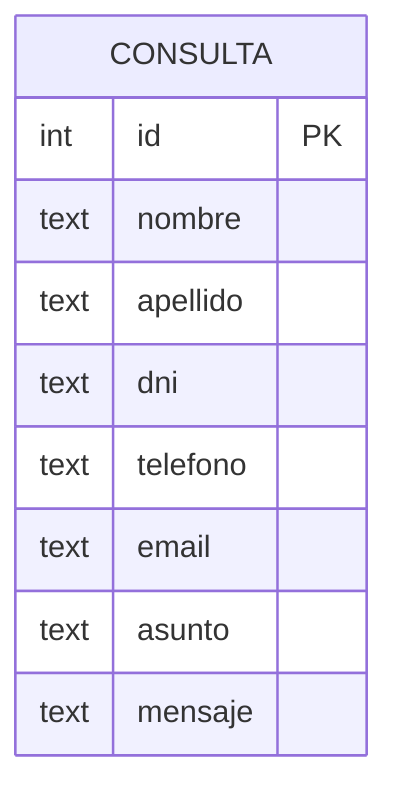

# Decisiones de diseño

## 1. Separación entre las vistas y el acceso a la API

### Código analizado

Se analizó la estructura del frontend, principalmente:

- `frontend/src/pages/ConsultaJuridica.jsx`
- `frontend/src/pages/ConsultasRecibidas.jsx`
- `frontend/src/services/formularioService.js`

`ConsultaJuridica.jsx` contiene la interfaz utilizada para completar y enviar una consulta jurídica.

`ConsultasRecibidas.jsx` contiene la vista destinada a obtener y mostrar las consultas recibidas.

`formularioService.js` centraliza las operaciones HTTP relacionadas con los formularios y define las funciones:

- `crearFormulario(formulario)`
- `obtenerFormulario(id)`
- `obtenerFormularios()`

### Diagnóstico

Durante el desarrollo se observó que distintas páginas del frontend necesitan comunicarse con el backend para enviar y obtener formularios.

Una alternativa era realizar las llamadas HTTP directamente dentro de cada página. Sin embargo, esto haría que los componentes encargados de la interfaz también conozcan detalles de la comunicación con la API, como las URLs de los endpoints, los métodos HTTP y el tratamiento básico de las respuestas.

Esto generaría dos motivos diferentes de cambio dentro de las páginas:

1. Cambios relacionados con la presentación y la interacción con el usuario.
2. Cambios relacionados con la comunicación con el backend.

A medida que se incorporen nuevas operaciones, distribuir esta lógica entre distintas vistas puede aumentar el costo de mantenimiento y provocar duplicación.

Por este motivo se analizó separar ambas responsabilidades, aplicando criterios de mantenibilidad, Clean Code y separación de responsabilidades trabajados en clase.

### Alternativas consideradas

1. **Realizar las llamadas HTTP directamente dentro de cada página.**

   Es la alternativa más simple y requiere menos archivos. Para una aplicación muy pequeña podría ser suficiente.

   Sin embargo, las páginas quedarían responsables tanto de la presentación como de detalles de infraestructura relacionados con la API.

2. **Centralizar las llamadas HTTP dentro de `frontend/src/services/`.**

   Agrega una capa adicional, pero evita distribuir URLs, métodos HTTP y manejo básico de errores entre las distintas vistas.

   También permite reutilizar las operaciones y concentrar futuros cambios en la comunicación con el backend.

3. **Incorporar un patrón de diseño adicional.**

   Se consideró introducir un patrón de diseño, pero no se encontró un problema concreto que justificara agregar esa complejidad.

   Se decidió no incorporar un patrón únicamente por utilizarlo, ya que una separación mediante servicios resulta suficiente para el problema actual.

### Decisión

Se decidió separar las responsabilidades de presentación y comunicación con la API.

Las páginas se mantienen responsables de la presentación de información, del estado de la interfaz y de la interacción con el usuario, mientras que las operaciones HTTP relacionadas con formularios fueron centralizadas en `frontend/src/services/formularioService.js`.

El servicio implementa:

- `crearFormulario(formulario)`, que realiza `POST /formulario`.
- `obtenerFormulario(id)`, que realiza `GET /formulario/:id`.
- `obtenerFormularios()`, que realiza `GET /formulario`.

`ConsultaJuridica.jsx` utiliza `crearFormulario()` para enviar los datos ingresados por el usuario. La vista administra los estados de envío, éxito y error, pero no contiene los detalles de la petición HTTP.

`ConsultasRecibidas.jsx` utiliza `obtenerFormularios()` para obtener los formularios del backend. Los datos simulados que se utilizaron durante el desarrollo fueron eliminados una vez que los endpoints estuvieron disponibles.

De esta manera, ambas vistas utilizan una misma capa para acceder a la API sin repetir la lógica de comunicación.

### Evidencia y trade-offs

Como evidencia se cuenta con:

- `ConsultaJuridica.jsx`, que utiliza `crearFormulario()` para enviar una consulta.
- `ConsultasRecibidas.jsx`, que utiliza `obtenerFormularios()` para cargar las consultas recibidas.
- `formularioService.js`, que centraliza las operaciones HTTP relacionadas con formularios.
- Los endpoints `POST /formulario`, `GET /formulario` y `GET /formulario/:id` implementados en el backend.
- La configuración de CORS necesaria para permitir la comunicación entre el frontend y el backend durante el desarrollo.
- La prueba de integración realizada ejecutando frontend y backend mediante Docker.

Se verificó el flujo completo creando una consulta desde `ConsultaJuridica.jsx` y comprobando posteriormente que la misma consulta apareciera en `ConsultasRecibidas.jsx`.

El recorrido comprobado fue:

`ConsultaJuridica.jsx` → `formularioService.js` → `POST /formulario` → backend → `GET /formulario` → `formularioService.js` → `ConsultasRecibidas.jsx`.

**Beneficios:**

- Evita repetir URLs y detalles HTTP entre diferentes páginas.
- Mantiene las vistas enfocadas principalmente en presentación, estado e interacción.
- Centraliza cambios futuros relacionados con la API.
- Facilita reutilizar las mismas operaciones desde distintas partes del frontend.
- Reduce la cantidad de responsabilidades concentradas en los componentes.
- Permite reemplazar o modificar detalles de comunicación sin distribuir el cambio entre todas las vistas.

**Costos y desventajas:**

- Introduce una capa y un archivo adicional.
- Requiere mantener correctamente la separación entre vistas y servicios.
- Para una aplicación muy pequeña, realizar directamente un `fetch` desde una página sería más sencillo.

Se consideró que este costo es aceptable porque la aplicación ya requiere distintas operaciones sobre formularios y se prevé incorporar otras funcionalidades que también necesitarán comunicación con el backend.

La decisión busca reducir el costo de cambios futuros sin introducir complejidad que actualmente no sea necesaria.

## 2. Unificación del contrato de datos de los formularios

### Código analizado

Se analizaron principalmente:

- `frontend/src/pages/ConsultaJuridica.jsx`
- `frontend/src/pages/ConsultasRecibidas.jsx`
- `frontend/src/services/formularioService.js`
- `backend/models/formulario.ts`
- `backend/controllers/formulario.controller.ts`

El modelo de formulario utilizado como referencia contiene los siguientes campos:

- `id`
- `nombre`
- `apellido`
- `dni`
- `telefono`
- `email`
- `asunto`
- `mensaje`

Durante la revisión se detectó que las distintas partes de la aplicación no representaban un formulario de la misma manera.

### Diagnóstico

`ConsultaJuridica.jsx` manejaba originalmente los campos:

- `nombre`
- `email`
- `telefono`
- `area`
- `mensaje`

Además, el campo `nombre` contenía conjuntamente nombre y apellido.

En cambio, `backend/models/formulario.ts` definía:

- `id`
- `nombre`
- `apellido`
- `dni`
- `telefono`
- `email`
- `asunto`
- `mensaje`

Por su parte, los datos simulados utilizados originalmente por `ConsultasRecibidas.jsx` ya seguían esta segunda estructura.

Esto producía una inconsistencia concreta: la vista encargada de mostrar formularios esperaba información que la vista encargada de crearlos nunca generaba.

También existía una diferencia semántica entre `area` en el formulario de envío y `asunto` en el modelo.

Si se conectaba el frontend con la API sin corregir previamente esta inconsistencia, el contrato entre ambas partes no habría coincidido.

### Alternativas consideradas

1. **Mantener estructuras diferentes y transformar los datos al realizar el envío.**

   Se podría haber mantenido `ConsultaJuridica.jsx` sin cambios y construir posteriormente un objeto compatible con el backend.

   Esto habría requerido separar manualmente nombre y apellido, decidir cómo transformar `area` en `asunto` y obtener un DNI que el formulario ni siquiera solicitaba.

   Por lo tanto, además de agregar lógica de transformación, algunos datos necesarios directamente no estaban disponibles.

2. **Modificar el modelo del backend para adaptarlo al formulario existente.**

   Era técnicamente posible simplificar el modelo para que coincidiera con la interfaz existente.

   Sin embargo, la estructura acordada para los formularios ya contemplaba apellido, DNI y asunto, y los datos simulados de `ConsultasRecibidas.jsx` utilizaban esa estructura.

3. **Unificar el formulario de entrada con el modelo acordado.**

   Esta alternativa permite que las distintas partes del sistema trabajen sobre una misma representación del formulario y evita transformaciones innecesarias.

### Decisión

Se decidió modificar `ConsultaJuridica.jsx` para utilizar los mismos campos acordados para los formularios:

- `nombre`
- `apellido`
- `dni`
- `telefono`
- `email`
- `asunto`
- `mensaje`

El campo `id` no se solicita al usuario porque corresponde a la identificación del formulario una vez creado. Su generación queda a cargo del backend.

También se corrigió el comportamiento del mensaje de éxito.

Anteriormente la interfaz podía indicar localmente que una consulta había sido enviada aunque todavía no existiera una operación real contra el servidor. Durante el refactor se eliminó ese comportamiento.

Una vez implementada la integración, el mensaje de éxito se incorporó nuevamente, pero ahora se muestra únicamente después de que `crearFormulario()` finaliza correctamente.

Si la petición falla, la vista muestra un estado de error en lugar de informar un envío exitoso.

De esta manera, el estado presentado al usuario corresponde al resultado real de la operación.

### Evidencia y trade-offs

La inconsistencia fue detectada comparando directamente:

- El estado `formData` original de `ConsultaJuridica.jsx`.
- La interfaz `Formulario` definida en `backend/models/formulario.ts`.
- Los datos simulados utilizados originalmente por `ConsultasRecibidas.jsx`.

Como resultado del cambio, `ConsultaJuridica.jsx` genera actualmente los campos:

`nombre`, `apellido`, `dni`, `telefono`, `email`, `asunto` y `mensaje`.

Estos datos son enviados mediante `crearFormulario()` a `POST /formulario`.

El backend genera el `id` y devuelve el formulario creado. Posteriormente, `GET /formulario` devuelve formularios con la misma estructura, que son consumidos por `ConsultasRecibidas.jsx`.

La compatibilidad del contrato fue comprobada mediante una prueba de integración completa: se creó un formulario desde la interfaz y posteriormente se obtuvo y mostró correctamente desde la vista de consultas recibidas.

**Beneficios:**

- Reduce inconsistencias entre frontend y backend.
- Evita transformaciones innecesarias antes de enviar los datos.
- Hace explícito qué información compone una consulta.
- Permite integrar directamente las vistas con la API.
- Reduce el riesgo de que una vista espere información que otra parte del sistema nunca genera.
- El mensaje de éxito representa ahora el resultado real de la operación y no solamente un cambio local de estado.

**Costos y desventajas:**

- Fue necesario modificar una interfaz que ya estaba desarrollada.
- El formulario pasó a solicitar más información al usuario.
- Frontend y backend quedan vinculados a un contrato que deberá mantenerse de forma coordinada cuando cambie.

Se consideró que estos costos son menores que mantener representaciones incompatibles del mismo concepto dentro del sistema.

## 3. Preparación de aplicación, validación y memoria aislada

Los apartados anteriores conservan el registro histórico. Las decisiones siguientes corresponden a la corrección de deuda técnica verificada el 14 de noviembre de 2026.

El controlador anterior mezclaba transporte, validación, parseo JSON y generación de IDs. Ahora `backend/app.ts` prepara Express sin escuchar; `index.ts` valida configuración e inicia el servidor. El router entrega un almacén al controlador, que coordina un validador puro y las operaciones de datos.

`validarFormulario(unknown)` comprueba estructura, presencia, tipos y correo mínimo antes de producir los siete campos conocidos. El almacén conserva objetos en un arreglo privado por instancia, genera máximo ID + 1 y devuelve copias. Las conversiones JSON permanecen únicamente en el transporte. Se conserva el seed y la pérdida de consultas al reiniciar.

Se descartaron un servicio que solo delegara, un Repository genérico y un contenedor de dependencias: las tres operaciones actuales no justifican esas capas. Las factorías y la colaboración explícita permiten aislar pruebas; no acreditan por sí solas un patrón GoF. El costo es mantener firmas entre módulos y copiar registros escalares al entrar/salir.

La evidencia automatizada comprueba creación/listado/detalle, mensajes y estados históricos, IDs, copias y aislamiento. La matriz de entradas inválidas verifica registros y siguiente ID después de cada rechazo. El límite sigue siendo 102400 bytes con respuesta 413; los errores nuevos conservan `message` y no revelan cuerpos ni trazas.

## 4. Pruebas automatizadas y comprobación estática

Se reutilizaron `node:test`, `assert`, `fetch` y tsx en backend; no se agregó un runner. Un helper abre explícitamente `127.0.0.1:0` y garantiza el cierre. Su prueba sintética es independiente de Express; otras pruebas comprueban su integración y que preparar la app no inicia escucha.

En frontend se eligieron Vitest 5.1.0, jsdom 31.0.1 y cuatro paquetes Testing Library para probar comportamiento, roles y teclado sin requerir un navegador instalado. Los seis paquetes son dependencias de desarrollo; no se añadieron dependencias runtime. Su costo incluye transitivas y mayor imagen de desarrollo. Se comprobaron engines/peers antes de instalar y se conservaron React/Vite/Express/TypeScript.

El perfil TypeScript incluye fuentes, pruebas y helpers, con strict, noEmit y skipLibCheck false. El tipo Node directo se alineó con la familia 22 (22.20.0); se inspeccionaron transitivas sin imponer overrides. La prueba negativa usa el script y configuración reales, comprueba el inventario y exige TS2322 en una copia temporal fiel. Verifica huellas de los originales y limpia solo su temporal.

Los comandos de prueba, tipos, lint y build están en README. Se distinguen las pruebas automatizadas ejecutadas, la revisión manual del prototipo confirmada por el usuario y las verificaciones de Docker; las interfaces y funcionalidades nuevas requerirán revisiones propias. No se exige TDD estricto ni un porcentaje arbitrario de cobertura.

## 5. Errores útiles y formulario accesible

El servicio conserva sus tres operaciones y valida el estado HTTP y la forma mínima de las respuestas. Solo comunica mensajes de cliente conocidos; red, servidor, protocolo y configuración utilizan explicaciones locales seguras. No hay reintentos automáticos: una respuesta perdida no demuestra que el servidor no registró la consulta.

Las vistas conservan valores ante error, permiten un nuevo intento manual y limpian solo tras creación confirmada. Los siete controles tienen `id` y `htmlFor`; se mantienen controles nativos y orden normal de foco. Las regiones `status` y `alert` comunican cambios sin depender del color. El aviso de envío queda fuera del formulario ocupado para permitir anunciar el progreso.

Testing Library verifica nombres, activación de etiquetas, tabulación, estados y navegación, incluidos fallos. Esa evidencia automatizada no acredita por sí sola anuncios percibidos en un lector real. La revisión manual del prototipo fue completada satisfactoriamente por el usuario con Chrome y Narrador de Windows en Windows 10, después de las correcciones de CORS y de la CLI Docker. El usuario confirmó teclado, foco visible, identificación de los siete campos, validación, anuncios de pendiente/éxito/error, conservación de campos ante fallos, limpieza solo tras éxito y navegación por consultas, incluido un fallo de red con el backend detenido. Es evidencia humana aportada por el usuario, no una evaluación realizada por Codex ni una prueba nueva de esta actualización documental. Las pantallas o funcionalidades nuevas y los cambios en esos flujos requerirán revisiones propias. No se promete conformidad completa con una norma de accesibilidad.

## 6. Configuración pública y exclusiones Docker

`VITE_API_BASE_URL` conserva localhost por defecto y admite una base HTTP(S) pública con prefijo; se resuelve al operar. `CORS_ORIGINS` admite una lista explícita de orígenes. Una configuración inválida no cae silenciosamente a otro destino; CORS no se presenta como autorización. Compose transmite ambas variables al proceso y no entrega credenciales al navegador.

Los Dockerfiles y el entorno de desarrollo se conservan. Ambos `.dockerignore` excluyen archivos de entorno, credenciales y claves de las categorías acordadas, en raíz y directorios anidados, sin excluir manifiestos ni todos los JSON.

`scripts/verificar-docker.mjs` utiliza Node, Docker/Buildx y tar del sistema. Comprueba la política con 24 fixtures UUID ficticios por componente y controles públicos; después inspecciona configuración y todas las capas guardadas con `image save --output`. Las autopruebas verifican fugas deliberadas, incluso en una capa borrada después, y errores cerrados. El formato OCI de Docker 29 incluye procedencia JSON; se inspecciona explícitamente en lugar de omitirla.

Se verificaron contextos e imágenes reales de ambos componentes y un proyecto Compose de prueba propio con defaults y destino/origen 127.0.0.1. HTTP, configuración pública de Vite y reinicio real del backend conservaron el comportamiento esperado; se retiraron los recursos propios. La prueba de cabeceras no sustituye la comprobación de CORS efectivo en un navegador real. El usuario confirmó posteriormente el protocolo del prototipo con Chrome y Narrador en localhost y 127.0.0.1, incluida esa comprobación. Esta evidencia humana complementa las verificaciones automatizadas existentes; no se repitieron durante esta actualización ni acreditan funcionalidades futuras.

El costo de esta verificación es necesitar Docker/Buildx/tar y tiempo de construcción/inspección. Su cobertura se limita a categorías y formatos ensayados. No se incorporan base de datos, autenticación, proxy, TLS ni despliegue productivo; el prototipo continúa destinado a demostración con datos ficticios.

## 7. Decisiones aprobadas para el primer incremento de persistencia

**Fecha:** 15 de noviembre de 2026. **Fuente:** aprobación expresa de Homero en la revisión supervisada de D01–D04.

Este apartado registra acuerdos para una implementación futura. Los apartados 1–6 conservan los antecedentes y el estado del prototipo refactorizado; el código todavía utiliza memoria. No se instalaron dependencias, ejecutaron migraciones ni verificaron conexiones PostgreSQL/Supabase en esta actualización. Registrar decisiones no completa P01–P04 ni autoriza comenzar su ejecución.

### D01 — Alcance aprobado

El primer incremento persistirá localmente las consultas existentes, conservando frontend, backend y endpoints. Comprende PostgreSQL con Docker, adaptación asíncrona, migraciones y pruebas. Quedan fuera cuentas, clientes registrados, representantes, casos, mensajes y Caddy.

P04 tiene dos hitos: persistencia local y posterior validación real contra PostgreSQL de Supabase. El hito remoto permanece pendiente hasta ejecutarse; el éxito local no acredita Supabase ni completa toda P04. No se requiere resolver funcionalidades futuras para trabajar en el hito local.

### D02 — Modelo y comportamiento aprobados

Se utilizará `app.consultas`, sin relaciones con entidades futuras:

| Campo | Definición aprobada para el modelo mínimo |
| --- | --- |
| `id` | `INTEGER`, clave primaria generada por PostgreSQL; no ingresado por el cliente. No se exige una secuencia sin huecos. |
| `nombre`, `apellido`, `dni`, `telefono`, `email`, `asunto`, `mensaje` | `TEXT NOT NULL` en cada columna, sin límites individuales ni unicidad nueva de DNI/correo. |

Cada fila conserva el contacto declarado al enviar la consulta como información histórica. Una consulta inicial no constituye un caso jurídico. Bajo esta semántica, la dependencia funcional relevante es `id → los siete campos`: valores del dominio por columna (1FN), dependencia de la clave simple completa (2FN) y ausencia de dependencias transitivas declaradas entre atributos no clave (3FN). No se supone que DNI o correo determinen el contacto vigente de una persona.

DER mínimo aprobado para este incremento:

La base persistente comienza vacía. Los registros ficticios solo se utilizan en pruebas o demostraciones explícitas, sin inserción automática en cada arranque.

Se aprueba rechazar con HTTP 400 los textos con NUL o Unicode mal formado antes de insertar, sin modificar silenciosamente su contenido. Deben agregarse regresiones y conservar los demás comportamientos válidos: campos, rutas, estados y mensajes existentes, valores sin recortes, límite del cuerpo y validaciones actuales de DNI, teléfono y correo.

El DER de seis entidades en [discusion-tecnica.md](discusion-tecnica.md) se conserva como **propuesta conceptual futura no aprobada**. Sus cardinalidades, perfiles, claves y reglas de acceso no se trasladan al esquema inicial.

### D03 — Selección provisional y condiciones pendientes

Se aprueban provisionalmente Sequelize 6, controlador `pg` y migraciones versionadas con Umzug, con organización mínima de conexión, modelo y acceso a datos. No se agregan capas de delegación ni patrones sin una necesidad concreta.

Antes de instalar deben verificarse y registrarse:

- Compatibilidad real con Node.js, TypeScript, ESM y pnpm del proyecto, versiones exactas y forma de cargar las migraciones. Distinguir soporte declarado de comprobaciones efectivamente ejecutadas.
- Necesidad de `pg-hstore` para la versión y los tipos utilizados: no se presume ni su inclusión ni su ausencia.
- Esquema del historial de Umzug y privilegios, incluida la preparación del esquema antes de inicializar el historial.

**Propuesta técnica pendiente de validación:** tabla de historial `app."SequelizeMeta"`, separada de las entidades de negocio.

| Rol técnico propuesto | Privilegios a validar |
| --- | --- |
| Migrador | Preparar y usar el esquema `app` (`CREATE`/`USAGE`), aplicar DDL sobre los objetos del incremento y mantener el historial con `SELECT`/`INSERT`/`DELETE` y permisos de creación. |
| Aplicación | `USAGE` del esquema, `SELECT`/`INSERT` sobre `app.consultas` y permisos necesarios sobre su secuencia; sin DDL ni permisos sobre el historial. |

La aprobación provisional no acredita estas verificaciones ni habilita instalaciones ahora. Las pruebas de compilación, carga de migraciones y acceso real deberán aportar evidencia cuando se autorice su ejecución. Se prohíben `sync({ force: true })` y `sync({ alter: true })` como sustitutos de migraciones.

La memoria se conserva para pruebas aisladas; no es un fallback ante fallos PostgreSQL. Los errores de conexión o persistencia deben tratarse explícitamente y sin revelar credenciales.

### D04 — Entornos aprobados y validaciones pendientes

Se aprueba PostgreSQL local mediante Docker, con desarrollo y pruebas separados. La infraestructura debe ser reproducible, sencilla y sin scripts innecesarios. No se utilizarán datos personales reales ni credenciales compartidas para pruebas.

Quedan pendientes verificar la imagen y versión concreta, volúmenes, configuración, credenciales propias, permisos, conexión, inicialización y limpieza protegida de recursos descartables. Una configuración ausente o un destino no autorizado deben impedir pruebas destructivas; nunca se limpiarán bases existentes, compartidas o reales para acelerar el desarrollo.

La configuración y las migraciones deben permitir una conexión posterior con Supabase. Proyecto, conectividad, modo directo o agrupado y TLS se resolverán y comprobarán en ese hito; no se presupone que cambiar una URL demuestre compatibilidad.

De D06 solo se consideran ahora los privilegios técnicos y la exposición de datos del entorno controlado. La autorización funcional de clientes sigue pendiente. Persistencia no autoriza despliegue público ni uso con información personal real.

Los pendientes se evaluarán mediante los criterios de [planificación.md](planificación.md). Homero conserva P01–P04 y P13; Martín mantiene P11/P12. Las asignaciones del equipo continúan siendo propuestas y cada tarea requiere evidencia para su cierre.
