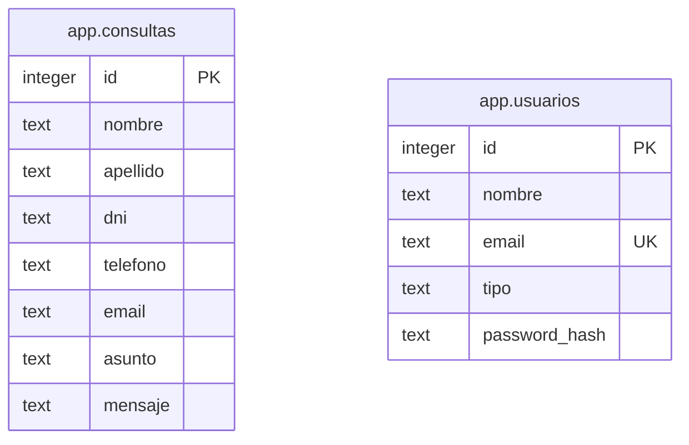

# Decisiones de diseño

Decisiones que explican el funcionamiento actual de Docker-laws, con sus razones, costos y evidencia. Los procedimientos están en el [README](../README.md) y el recorrido técnico para el Taller III está en [PREPARACION.md](../PREPARACION.md).

## 1. Separación entre las vistas y el acceso a la API

Las páginas se mantienen responsables de la presentación, el estado de la interfaz y la interacción con el usuario. `formularioService.js` centraliza la creación, el listado y el detalle de formularios. `authService.js` centraliza las operaciones de cuenta y sesión. Esta separación concentra URLs, métodos HTTP, formato de respuestas, encabezados y tratamiento de errores en los servicios. [Servicio de formularios](../frontend/src/services/formularioService.js) · [Servicio de cuentas](../frontend/src/services/authService.js).

Un `fetch` en cada vista requiere menos archivos, pero distribuye los detalles de comunicación entre componentes. La capa de servicios agrega un punto de mantenimiento y permite reutilizar operaciones y probar las vistas con red controlada. Una abstracción genérica adicional requeriría otro motivo de cambio. [Vista de envío](../frontend/src/pages/ConsultaJuridica.jsx) · [Vista de listado](../frontend/src/pages/ConsultasRecibidas.jsx) · [Recorrido de interfaz](../frontend/src/App.test.jsx).

## 2. Unificación del contrato de datos de los formularios

El formulario de entrada y la API comparten `nombre`, `apellido`, `dni`, `telefono`, `email`, `asunto` y `mensaje`. La respuesta de creación agrega un `id` generado por PostgreSQL y las respuestas de lectura conservan esa forma. Un contrato común evita inferir campos que la vista no recoge y hace explícito qué información viaja de cada capa a la siguiente. Los cambios al contrato requieren coordinar frontend, API y pruebas. [Tipos de formularios](../backend/models/formulario.ts) · [Servicio HTTP](../frontend/src/services/formularioService.js) · [Prueba del contrato](../backend/tests/formulario.http.test.ts#L11).

La validación recibe entrada desconocida, comprueba presencia, tipo, correo y texto válido, y proyecta solo los siete campos. Los valores válidos se conservan sin recortes. DNI y teléfono son texto sin formatos nacionales nuevos. El identificador y las propiedades extra enviados por el cliente quedan fuera del objeto a persistir. El límite del cuerpo se aplica antes del almacenamiento. [Validador](../backend/validations/formulario.validation.ts) · [Límite HTTP](../backend/tests/formulario.http.test.ts#L173).

## 3. Preparación de aplicación, validación y memoria aislada

`app.ts` prepara Express sin escuchar. `index.ts` valida el entorno, se conecta a PostgreSQL, verifica esquema y permisos y controla escucha y cierre. Los controladores usan contratos asíncronos de datos inyectados. Las conversiones JSON quedan en el transporte y el acceso real se concentra en los adaptadores Sequelize. Esta frontera permite probar la API sin abrir una base por importar la aplicación. [Composición](../backend/app.ts) · [Arranque](../backend/index.ts) · [Pruebas de importación](../backend/tests/app.test.ts#L64).

La memoria sirve a instancias aisladas de prueba. Mantiene objetos privados y devuelve copias para evitar mutaciones desde el exterior. La ejecución normal proporciona los adaptadores PostgreSQL y falla de forma expresa cuando la base o el esquema requerido no están disponibles. Se evita una respuesta aparentemente exitosa contra un almacén distinto. [Almacén en memoria](../backend/data/formularios-guardados.ts) · [Almacén de consultas PostgreSQL](../backend/data/formularios-postgres.ts) · [Prueba de conexión cerrada](../backend/tests/formulario.postgres.test.ts#L253).

Los controladores de consultas coordinan validación y tres operaciones de datos. Un servicio que solo delegue, un repositorio genérico o un contenedor de dependencias añadirían pasos para ese caso. El servicio de cuentas sí concentra reglas de hashing, sesiones y permisos. El costo de la separación es mantener firmas coherentes entre módulos. [Controlador de consultas](../backend/controllers/formulario.controller.ts) · [Servicio de cuentas](../backend/services/auth.service.ts).

## 4. Pruebas automatizadas y comprobación estática

En backend se usa `node:test` con TypeScript ejecutado mediante `tsx`. El helper HTTP abre solo loopback y cierra su puerto. El perfil TypeScript estricto incluye fuentes, pruebas y helpers, con `noEmit` y `skipLibCheck: false`. La prueba de tipos verifica el comando efectivo, los archivos incluidos y la detección de `TS2322` en una copia temporal. Eso permite comprobar una falla de tipos sin introducirla en las fuentes. [Helper HTTP](../backend/tests/helpers/http.ts) · [Configuración TypeScript](../backend/tsconfig.json) · [Prueba de tipos](../backend/tests/typecheck.test.ts#L39).

Vitest, jsdom y Testing Library ejercitan la interfaz y los servicios con red controlada. La suite PostgreSQL emplea una base real descartable para verificar estructura, permisos y persistencia. Los dos entornos permiten aislar fallos de interfaz y de datos. El costo adicional de la integración física es contar con Docker y tiempo de inicialización. La evidencia y sus límites se detallan en [estrategia de pruebas](../PREPARACION.md#3-estrategia-y-ejecución-del-testing).

## 5. Errores útiles y formulario accesible

El cliente HTTP comprueba el estado esperado y la forma de la respuesta. Reproduce mensajes previstos y comunica de forma segura los fallos de red, servidor o configuración. El middleware de errores evita exponer detalles internos. El envío se confirma solo ante una respuesta válida. La vista conserva los valores ante error y permite reintentar manualmente, porque una respuesta perdida puede corresponder a una consulta ya registrada. [Servicio HTTP](../frontend/src/services/formularioService.js) · [Middleware de errores](../backend/middleware/error.middleware.ts) · [Prueba de estados y reintento](../frontend/src/pages/ConsultaJuridica.test.jsx#L32).

Los siete controles tienen `id` y etiquetas `htmlFor`. El formulario usa controles nativos y orden de foco normal. Las regiones `status` y `alert` comunican estados sin depender del color. El aviso de envío queda fuera del formulario ocupado para permitir anunciar el progreso. Testing Library comprueba nombres, activación de etiquetas, teclado y estados de interfaz. [Formulario](../frontend/src/pages/ConsultaJuridica.jsx) · [Prueba de etiquetas y tabulación](../frontend/src/pages/ConsultaJuridica.test.jsx#L16).

La revisión manual del prototipo de consultas fue confirmada por el usuario con Chrome y Narrador en Windows 10. Incluyó teclado, foco visible, identificación de los siete campos, validación, anuncios, conservación de valores ante fallo, limpieza tras éxito y navegación por consultas, con datos ficticios y un ensayo de red con el backend detenido. Esa evidencia corresponde al recorrido revisado. Las pantallas de cuentas tienen comprobaciones automatizadas en jsdom. [Pruebas de cuentas en la interfaz](../frontend/src/App.auth.test.jsx).

## 6. Configuración pública y exclusiones Docker

`VITE_API_BASE_URL` fija la dirección pública de la API al construir el frontend. Cambiar ese destino requiere reconstruir el bundle. `CORS_ORIGINS` delimita desde qué orígenes puede leerse la API en navegador. Las credenciales PostgreSQL se resuelven solo en el backend y la autorización de lecturas se comprueba en el servidor. Este diseño permite separar la configuración visible del navegador de la conexión a datos. [Resolución de la API](../frontend/src/config/apiConfig.js) · [Configuración CORS](../backend/config/app.config.ts) · [Configuración PostgreSQL](../backend/config/database.config.ts).

Ambos `.dockerignore` excluyen patrones de archivos de entorno, credenciales y claves en raíz y subdirectorios. El verificador usa marcadores ficticios y archivos públicos de control, e inspecciona contextos, configuraciones y capas. Una capa anterior puede conservar un archivo aunque se borre en otra posterior. La cobertura se limita a categorías y formatos ensayados. [Exclusiones backend](../backend/.dockerignore) · [Exclusiones frontend](../frontend/.dockerignore) · [Prueba de fuga en una capa](../scripts/verificar-docker.test.mjs#L243).

Las verificaciones TLS locales usan [material sintético documentado junto a los fixtures](../backend/tests/fixtures/tls-local/README.md), independiente de los certificados y credenciales de Supabase. [Prueba de CA y nombre del servidor](../backend/tests/database.supabase.test.ts#L143).

## 7. Persistencia y modelo de datos

### D01 — Alcance de la persistencia

PostgreSQL conserva consultas y cuentas entre reinicios del backend. Las migraciones crean las tablas de negocio sin cargar datos de ejemplo. La API utiliza adaptadores de datos aislados en las pruebas y PostgreSQL en el arranque habitual. El contrato de consultas mantiene sus siete campos y cubre envío, listado y detalle. [API de consultas](../backend/routes/formulario.routes.ts) · [Prueba de persistencia de consultas](../backend/tests/formulario.postgres.test.ts#L216) · [Prueba de persistencia de cuentas](../backend/tests/database.integration.test.ts#L174).

### D02 — Modelo y comportamiento

| Tabla | Responsabilidad | Campos y restricciones |
| --- | --- | --- |
| `app.consultas` | Guarda el contacto declarado y la solicitud de asesoramiento. | `id` como clave primaria. `nombre`, `apellido`, `dni`, `telefono`, `email`, `asunto` y `mensaje` son `TEXT NOT NULL`. Los datos de contacto pueden repetirse. |
| `app.usuarios` | Guarda la identidad de la cuenta, su tipo y el hash para autenticarla. | `id` como clave primaria. `nombre`, `email`, `tipo` y `password_hash` son `TEXT NOT NULL`. `email` es único. `usuarios_tipo_check` admite `cliente` o `representante`. |

Cada `id` es `INTEGER NOT NULL` y PostgreSQL lo genera con la secuencia propia de la tabla, que puede dejar huecos. Los modelos desactivan `timestamps` y las tablas son independientes, sin claves foráneas entre ellas. Esto permite guardar el contacto de cada envío aun cuando la persona carezca de cuenta. [Modelo de consultas](../backend/models/consulta.model.ts) · [Migración de consultas](../backend/migrations/001-crear-consultas.ts) · [Modelo de usuarios](../backend/models/usuario.model.ts) · [Migración de usuarios](../backend/migrations/002-crear-usuarios.ts).

En `app.consultas`, la dependencia funcional relevante es `id → los siete campos`. Cada columna guarda un valor de su dominio, la clave es simple y el esquema carece de dependencias transitivas declaradas entre atributos no clave. Esa semántica mantiene el modelo de consultas en tercera forma normal.

Las entradas con NUL o Unicode mal formado reciben `400` antes de insertar, conservando el texto válido. La decisión protege la compatibilidad con PostgreSQL y mantiene los siete campos de la API. [Validación](../backend/validations/formulario.validation.ts) · [Regresión PostgreSQL](../backend/tests/formulario.postgres.test.ts#L195).

### D03 — Sequelize y migraciones explícitas

Sequelize 6 con `pg` permite mantener modelos y adaptadores comunes para PostgreSQL local y Supabase. Umzug registra los cambios de esquema en `app."SequelizeMeta"`, reservado al migrador. Las versiones fijadas están en los manifiestos y lockfiles. Las tablas de negocio usan `INTEGER` y `TEXT` y se verifican sin `pg-hstore`. [Dependencias](../backend/package.json) · [Runner](../backend/database/migrate.ts) · [Prueba de roles y esquema](../backend/tests/database.integration.test.ts).

La propiedad del esquema y los cambios DDL pertenecen al migrador. La aplicación recibe `SELECT` e `INSERT` sobre ambas tablas y `USAGE` sobre el esquema y sus secuencias. Esto reduce el alcance de la credencial usada por Express. El operador aplica las migraciones de forma explícita y Express comprueba el esquema y los permisos al iniciar. El costo operativo es preparar y verificar el esquema antes de desplegar. [Roles y procedimiento](../README.md#roles-y-permisos-de-postgresql) · [Arranque](../backend/index.ts).

### D04 — Entornos y TLS PostgreSQL

Docker separa el volumen de desarrollo de las bases descartables de pruebas. La limpieza se limita a proyectos nuevos cuya propiedad se comprueba. En Supabase, el perfil opta explícitamente por el destino remoto, separa credenciales por rol y exige CA vigente y comprobación del nombre del servidor. La selección falla de forma cerrada cuando falta configuración o se mezclan destinos. [Aislamiento local](../scripts/postgres.mjs) · [Perfil y TLS](../backend/config/database.config.ts).

El equipo verificó la conexión y la persistencia en su proyecto de desarrollo con Session pooler, TLS autenticado y roles separados. La conexión directa es una alternativa en el código. Las pruebas automatizadas de TLS reproducen certificados aceptados y rechazados en loopback. Las suites PostgreSQL con DDL y limpieza se ejecutan en local. [Verificación de TLS](../backend/tests/database.supabase.test.ts#L143) · [Configuración de Supabase](../README.md#configurar-supabase).

## 8. Identidad, sesiones y autorización

**D05 · Identidad y sesiones.** Las contraseñas se guardan con bcrypt y el perfil público excluye el hash. El login devuelve el mismo `401` para correo desconocido y contraseña incorrecta, y realiza una comparación bcrypt sintética cuando falta la cuenta. La validación compartida limita la contraseña a 72 bytes UTF-8 antes de usar el almacén. La unicidad de PostgreSQL protege el alta y permite informar `409` por duplicado, que revela la existencia de la cuenta. El límite de peticiones acota ese uso en la demostración. [Servicio de autenticación](../backend/services/auth.service.ts) · [Validación](../backend/validations/auth.validation.ts) · [Pruebas de credenciales](../backend/tests/auth.http.test.ts#L109).

La demostración usa tokens opacos con vencimiento de ocho horas. Las sesiones viven en memoria y se revocan con logout. Los cupos de tres sesiones por cuenta y 256 por proceso acotan el estado. El recorrido está diseñado para una sola instancia. Una instancia diferente o un reinicio exige volver a iniciar sesión. En el navegador, `sessionStorage` permite recuperar el perfil en la pestaña y borrar el token al cerrar sesión. [Servicio de sesiones](../backend/services/auth.service.ts) · [Cliente de cuentas](../frontend/src/services/authService.js) · [Pruebas de cupos](../backend/tests/auth.seguridad.test.ts).

**D06 · Acceso a consultas.** El envío es público. La lectura por listado o detalle requiere una sesión vigente, tipo `representante` e ID positivo autorizado de esa base en `AUTH_REPRESENTANTES_IDS`. Una lista ausente o vacía concede cero permisos y una entrada inválida impide el arranque. El registro público crea clientes. El script administrativo lee un JSON privado y reutiliza la validación y el servicio de cuentas para crear representantes. El alta y la habilitación son pasos separados. Una coincidencia con el correo de la consulta no concede acceso. [Autorización](../backend/middleware/sesion.middleware.ts) · [Configuración de IDs](../backend/config/app.config.ts) · [CLI de alta privada](../backend/scripts/crear-representante.ts) · [Procedimiento](../README.md#alta-privada-de-un-representante-ficticio).

La política aprobada permite a los representantes habilitados leer la colección completa de la **demostración con datos ficticios**. El modelo carece de pertenencia por consulta. Aplicar el sistema a información real requiere reglas de pertenencia y permisos por registro. La API comprueba el permiso antes de consultar la base. La interfaz refleja el permiso y retira los datos al vencer o perder acceso. Las respuestas de cuentas y lecturas protegidas usan `Cache-Control: no-store`. [Rutas protegidas](../backend/routes/formulario.routes.ts) · [Regresión de autorización](../backend/tests/auth.http.test.ts#L275).

Los límites de login, alta y envío se aplican por IP y proceso antes de sus controladores. Al alcanzar el cupo, `429` incluye `Retry-After`. Una instancia adicional conserva sus propios contadores. La IP confiable depende de la configuración del ingreso. [Limitador](../backend/middleware/limite-solicitudes.middleware.ts) · [Pruebas de límites](../backend/tests/auth.seguridad.test.ts#L27).

## 9. Transporte y confianza en proxies

La API protege las rutas de cuentas y lecturas con HTTPS en Render y en modo producción. Admite TLS directo o el protocolo HTTPS reenviado mediante un único encabezado reconocido por Express desde un proxy confiable. TLS hacia PostgreSQL se configura y comprueba por separado. [Guardia de transporte](../backend/middleware/sesion.middleware.ts) · [TLS PostgreSQL](../backend/database/connection.ts).

En Render, el proxy termina TLS y llega a Express por HTTP. `trust proxy = 1` permite reconocer el protocolo reenviado cuando `RENDER=true` y no hay lista explícita. `TRUST_PROXY_CIDRS` tiene prioridad y fuera de Render la confianza por defecto está desactivada. El modo de un salto presupone que el proxy es la única entrada y fija el protocolo y la IP reenviados. Si otra ruta alcanza el socket directamente, la confianza por distancia también cubre ese par y permite falsificar datos reenviados. Los rangos de salida de Render no identifican esos pares de entrada. [Configuración de Express](../backend/app.ts#L33) · [TLS de Render](https://render.com/docs/web-services#connecting-from-the-public-internet) · [Confianza de proxies](https://expressjs.com/en/guide/behind-proxies/) · [Rangos de salida](https://render.com/docs/outbound-ip-addresses).

El proxy TLS de prueba comprueba el login reenviado y los rechazos de protocolos ausentes o ambiguos y de pares ajenos a la lista explícita. La topología del servicio desplegado y la IP efectiva para los límites se revisan en el entorno real. [Pruebas de transporte](../backend/tests/auth.seguridad.test.ts#L150) · [Verificación operativa en Render](../README.md#render).

### Separación de servicios en el despliegue

Vercel sirve los archivos estáticos de Vite y reescribe las rutas configuradas a `index.html` para que React resuelva la navegación. Render ejecuta el proceso Express, que concentra la validación, la autorización y el acceso a datos. Supabase aloja PostgreSQL y permite reutilizar el esquema, los modelos y las migraciones probados con PostgreSQL local. [Build de Vercel](../frontend/vercel.json) · [Arranque de Express](../backend/index.ts) · [Conexión PostgreSQL](../backend/database/connection.ts).

La interfaz y la API pueden publicarse por separado. La integración exige coordinar el destino HTTPS de `VITE_API_BASE_URL`, el origen de la interfaz en `CORS_ORIGINS` y el perfil `supabase-dev` con TLS verificado en Render. Render usa el rol de aplicación. La credencial del migrador se reserva al procedimiento de migración. [Configuración de despliegue](../README.md#despliegue-en-render-y-vercel).
