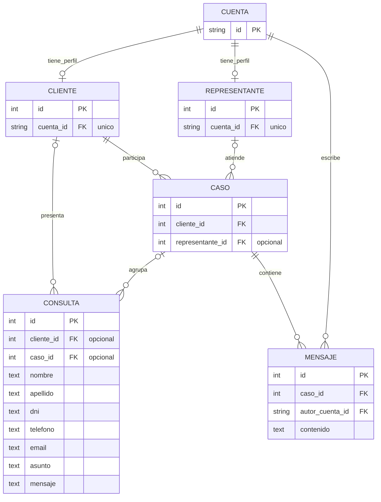

# Docker-laws: discusión exploratoria de D01–D09

## 1. Propósito, alcance y estado preliminar

Material de discusión para Homero, Matías, Nicolás y Martín, basado en el repositorio inspeccionado el 14 de noviembre de 2026. **No registra decisiones aprobadas ni autoriza implementar, instalar o desplegar.** Las previsiones de Taller II siguen **sujetas a consignas oficiales** del Taller III.

Se conservan los identificadores de [planificación.md](planificación.md), sin cambiar sus tareas ni asignaciones. Homero tiene propuestos P01–P04 y P13; Matías, los módulos backend; Nicolás, el frontend; Martín, P11/P12 e infraestructura de integración. La aceptación por los integrantes continúa pendiente.

Convenciones del documento:

- **Hecho comprobado:** observado en archivos, metadatos locales o documentación oficial citada. Leer un test no significa haberlo ejecutado.
- **Alternativa propuesta:** opción a evaluar; no es un requisito.
- **Recomendación provisional:** criterio técnico razonado, **pendiente de aprobación**.
- **Incógnita:** información de negocio, entorno o compatibilidad que falta comprobar.

Los costos se expresan como **bajo, medio o alto**, relativos al proyecto y separados en implementación/mantenimiento. Incluyen aprendizaje y operación; no son horas ni presupuestos del proveedor. No se verificaron tarifas ni se presuponen servicios gratuitos permanentes.

## 2. Resumen de la arquitectura actual

| Hecho comprobado | Evidencia y consecuencia |
| --- | --- |
| React y JavaScript con Vite; API Express y TypeScript | `frontend/package.json`, `backend/package.json`. El frontend no utiliza TypeScript actualmente. |
| Versiones diferenciadas de los rangos declarados | Manifiestos y lockfiles: Express 5.2.1, TypeScript 7.0.2, tsx 4.23.15, React/React DOM 19.3.0 y Vite 8.2.2 resueltos. Ambos proyectos declaran pnpm 12.3.4. Se consultó Node local: 22.23.4. Esto no prueba compatibilidad con paquetes todavía ausentes. |
| Aplicación separada del arranque | `backend/app.ts` crea Express; `index.ts` escucha en 3001. Controladores, validación, datos y errores están separados. |
| Almacenamiento síncrono y volátil | `backend/data/formularios-guardados.ts`: arreglo privado, copias, seed ficticio y máximo ID + 1. `AlmacenFormularios` se infiere de esa implementación concreta. |
| Contrato HTTP existente | `POST /formulario` crea con 201; `GET /formulario` lista; `GET /formulario/:id` devuelve un registro o 404. `/health` informa estado del proceso, sin comprobar una base de datos. |
| Modelo mínimo conocido | `backend/models/formulario.ts`: ID numérico y siete textos. El validador rechaza ausentes/blancos, tipos incorrectos y correo mínimo inválido; conserva valores válidos sin recortarlos. Límite total JSON: 102400 bytes. |
| Frontend desacoplado del transporte | `frontend/src/services/formularioService.js` centraliza HTTP y comprueba respuestas. Exige ID numérico entero positivo; `apiConfig.js` admite una base absoluta HTTP(S), con prefijo opcional. |
| Sin identidad ni permisos | `backend/app.ts` y router de formularios no autentican ni comprueban pertenencia. CORS no evita peticiones directas a la API. Persistir no autoriza usar ni publicar información personal real. |
| Docker de desarrollo | Compose tiene frontend/backend; el frontend ejecuta Vite. No hay PostgreSQL, Caddy ni configuración de HTTPS implementados. `.dockerignore` y `scripts/verificar-docker.mjs` protegen categorías ensayadas con fixtures sintéticos. |
| Pruebas y revisión humana existentes | Backend: `node:test`; frontend: Vitest/Testing Library; tipos, lint frontend y build. La revisión manual del prototipo con Chrome/Narrador fue confirmada por el usuario. Ninguna de estas evidencias verifica funcionalidades futuras. |

Flujo actual: formulario React → servicio HTTP → router/controlador Express → validación → almacén en memoria → respuesta; el listado recorre el mismo acceso y se representa en consultas recibidas. No hay creación de expedientes, sesiones ni mensajes independientes.

También se leyeron [README.md](../README.md) y [decisiones-diseno.md](decisiones-diseno.md). Las carpetas `backend/migrations/` y `seeders/` solo contienen reservas. Sequelize, su controlador PostgreSQL y un proveedor de identidad no están declarados como dependencias.

**Límite de esta inspección:** no se ejecutaron suites, instalaciones ni conexiones PostgreSQL/Supabase. Las consultas de versión mostraron Docker CLI 29.4.2 y Compose 5.1.3, con advertencia de acceso denegado a la configuración local; no acreditan disponibilidad del motor. No se evaluó un proyecto Supabase real.

## 3. Tabla de las nueve decisiones técnicas

| ID | Problema central | Dependencia principal | Cuándo resolver |
| --- | --- | --- | --- |
| D01 | Qué entrega autorizar y cómo coordinarla | Consignas, disponibilidad y alcance | Antes de ejecutar cada incremento. |
| D02 | Qué datos representan consultas y entidades futuras | Contrato actual y significado de cada dato | Modelo mínimo antes de P04; futuro por módulo. |
| D03 | Cómo modelar y evolucionar el esquema con herramientas compatibles | Node, TypeScript, ESM, Sequelize y migrador | Antes de instalar o escribir migraciones. |
| D04 | Dónde ejecutar PostgreSQL y cómo aislar accesos/pruebas | Red, credenciales, conexiones y entornos | Antes de P03/P04. |
| D05 | Cómo identificar usuarios y mantener sesiones | Flujos de cuenta todavía indefinidos | Antes de P05/P06. |
| D06 | Quién puede acceder a cada registro | Identidad, propiedad y representación | Antes de uso real y módulos protegidos. |
| D07 | Qué significa un caso y cómo se relaciona con consultas | Reglas jurídicas/operativas no confirmadas | Antes de P07/P08. |
| D08 | Qué comunicación ofrecer y dónde conservarla | Participantes, contexto y canal | Antes de P09/P10. |
| D09 | Cómo presentar interfaz/API con Docker y HTTPS | Entorno, rutas, dominio y certificados | Antes de P11; despliegue requiere autorización separada. |

## 4. Análisis individual de D01–D09

### D01 — Alcance y secuencia de entregas

**Problema y hecho:** el proyecto tiene un recorrido de consultas verificable, pero faltan consignas definitivas. Desarrollar todas las previsiones ahora puede producir trabajo descartable y contratos incompatibles.

| Alternativa propuesta | Ventaja | Desventaja y riesgo | Costo implementación/mantenimiento |
| --- | --- | --- | --- |
| A. Primero persistir consultas con P01–P04 | Resultado acotado y comprobable; Homero puede ejecutar ese bloque sin disponibilidad ajena. | Requiere cuidar contratos y seguridad aunque use datos ficticios. | Medio/bajo a medio. |
| B. Diseñar e implementar juntas todas las funcionalidades previstas | Permite una demostración amplia si las previsiones coinciden. | Alta incertidumbre, integración tardía y mayor conflicto entre archivos. | Alto/alto. |
| C. Postergar toda implementación hasta las consignas | Reduce trabajo basado en supuestos. | Demora aprendizaje e integración de persistencia ya prevista. | Bajo ahora; esfuerzo futuro pendiente. |

**Recomendación provisional:** A, si el equipo autoriza un primer alcance con datos ficticios. Mantener B fuera de ejecución hasta confirmar módulos. **Preguntas:** ¿qué demuestra la primera entrega?, ¿cuánta disponibilidad acepta cada integrante? **Ahora:** discutir ese alcance y evidencias. **Postergar:** compromisos académicos o fechas definitivas.

### D02 — Modelo de datos

**Problema y hecho:** hoy cada registro representa una solicitud con datos de contacto. No existe una entidad cliente ni una regla que convierta automáticamente una consulta en expediente.

| Alternativa propuesta | Ventaja | Desventaja y riesgo | Costo implementación/mantenimiento |
| --- | --- | --- | --- |
| A. Una tabla de consultas con los siete campos actuales | Conserva el flujo y permite migraciones pequeñas. | Repite contacto entre solicitudes; debe aclararse si representa una captura histórica. | Bajo/bajo inicialmente. |
| B. Cliente y consulta separados desde el inicio | Prepara perfiles y evita repetir datos de contacto actuales. | Obliga a decidir identidad, asociación y consultas anónimas antes de necesitarlas. Asociar por correo o DNI sería inseguro sin reglas. | Medio/medio. |
| C. Crear ahora clientes, representantes, casos y mensajes | Ofrece una visión global anticipada. | Fija cardinalidades y permisos todavía desconocidos; puede exigir rediseño. | Alto/alto mientras cambie el alcance. |

**Recomendación provisional:** A y un bosquejo conceptual futuro, sin crear sus tablas. Se desarrolla en 5.1 y 6. **Preguntas:** ¿el contacto de una consulta debe conservarse aunque cambie el perfil?, ¿cómo se vincularía una consulta previa con una cuenta? **Ahora:** acordar el modelo mínimo, IDs y límites del contrato. **Postergar:** relaciones futuras no confirmadas.

### D03 — Sequelize y migraciones

**Problema y hecho:** un ORM facilita el acceso relacional, pero no elimina SQL, validación ni diseño. Hoy el controlador espera resultados inmediatos; PostgreSQL obliga a tratar promesas, conexiones y fallos.

| Alternativa propuesta | Ventaja | Desventaja y riesgo | Costo implementación/mantenimiento |
| --- | --- | --- | --- |
| A. Sincronización automática desde modelos | Experimentación rápida en una base descartable. | No explica la evolución de datos; `force` borra y `alter` puede ser destructivo. No debe alterar una base compartida al arrancar. | Bajo/alto si el esquema evoluciona. |
| B. Migraciones versionadas con Sequelize CLI | Flujo conocido, cambios revisables e historial. | Debe verificarse el encaje del CLI y sus archivos con ESM/TypeScript. | Medio/medio. |
| C. Migraciones con un runner programático, como Umzug | Mayor control sobre carga de módulos y conexión. | Dependencia y configuración adicionales; el equipo mantiene esa integración. | Medio a alto/medio. |

**Hecho documental:** Sequelize presenta v6 como actual y v7 como alfa; su documentación advierte que el CLI no está listo para v7. Esto favorece evaluar primero v6, sin fijar aún un parche. [Versiones](https://sequelize.org/releases/), [advertencia del CLI](https://sequelize.org/docs/v7/cli/).

**Recomendación provisional:** migraciones versionadas; evaluar B con v6 y elegir C si la compatibilidad requiere una solución más mantenible. No adoptar A como mecanismo de evolución. **Preguntas:** ¿qué combinación exacta funciona con el entorno actual?, ¿quién y cuándo ejecuta migraciones? **Ahora:** comprobar y aprobar herramientas. **Postergar:** decoradores, capas genéricas y actualizaciones ajenas a persistencia.

### D04 — Supabase y entornos

**Problema y hecho:** todavía no hay PostgreSQL configurado. Hay que elegir dónde experimentar sin que pruebas o limpiezas afecten datos compartidos.

| Alternativa propuesta | Ventaja | Desventaja y riesgo | Costo implementación/mantenimiento |
| --- | --- | --- | --- |
| A. Solo PostgreSQL local con Docker | Trabajo aislado, sin depender de red remota; pruebas descartables. | El equipo mantiene contenedores/volúmenes; no verifica integración Supabase ni sus servicios. | Bajo a medio/medio. |
| B. Solo Supabase administrado | Prueba temprana del proveedor previsto; menos operación del motor. | Dependencia de red, credenciales y condiciones del servicio; mayor impacto de una limpieza equivocada. | Medio/medio, más costo del servicio por verificar. |
| C. Desarrollo/pruebas locales y validación separada en Supabase | Combina aislamiento con comprobación del destino previsto. | Exige mantener versiones, esquema y configuración coherentes entre entornos. | Medio/medio. |

**Recomendación provisional:** C, comenzando localmente si se aprueba. PostgreSQL local no acredita por sí solo el cierre de la integración Supabase de P04. **Preguntas:** ¿quién administra el proyecto y sus accesos?, ¿qué conexión permite la red del equipo? **Ahora:** entornos, credenciales, aislamiento y limpieza. **Postergar:** recursos de producción y tamaños de servicio. Detalle en 5.3.

### D05 — Autenticación y sesiones

**Problema y hecho:** no hay cuentas. Autenticar responde quién realiza una solicitud; no decide qué consultas puede ver.

| Alternativa propuesta | Ventaja | Desventaja y riesgo | Costo implementación/mantenimiento |
| --- | --- | --- | --- |
| A. Supabase Auth y verificación de identidad en Express | Evita administrar contraseñas directamente y encaja con el proveedor previsto. | Integra SDK o verificador, expiración, renovación y dependencia externa. El backend no recibe automáticamente la identidad del navegador. | Medio/medio. |
| B. Cuentas y sesiones en Express con bibliotecas maduras | Control de flujos y menor dependencia del proveedor de identidad. | El equipo mantiene hashes, sesiones, expiración y los flujos de cuenta aprobados; superficie de seguridad mayor. | Alto/alto. |

**Recomendación provisional:** evaluar A primero si las consignas admiten identidad administrada. Un token decodificado no está validado: Express debe comprobar firma y condiciones del emisor antes de confiar en la identidad. La guía oficial explica la verificación de JWT. [Supabase Auth](https://supabase.com/docs/guides/auth), [JWT](https://supabase.com/docs/guides/auth/jwts).

**Preguntas:** ¿cómo se crean clientes y representantes?, ¿qué flujos de cuenta son necesarios? **Ahora:** comparar responsabilidades. **Postergar:** elegir proveedor y bibliotecas hasta definir esos flujos. También falta elegir transporte de sesión: cookies requieren controles CSRF y configuración de seguridad; tokens accesibles a JavaScript requieren considerar exposición por XSS y renovación. Ninguna opción se adopta aquí. [Sesiones en Express/Passport](https://www.passportjs.org/concepts/authentication/sessions/).

### D06 — Autorización y separación entre clientes

**Problema y hecho:** las consultas actuales son accesibles sin permisos. Conocer el ID o tener una sesión válida no demuestra derecho a leer un registro.

| Alternativa propuesta | Ventaja | Desventaja y riesgo | Costo implementación/mantenimiento |
| --- | --- | --- | --- |
| A. Permisos por recurso en Express y rol PostgreSQL limitado | Mantiene las reglas junto a la API y se integra con Sequelize. | Una consulta SQL sin filtro de pertenencia puede filtrar datos. Se deben revisar otras vías de acceso a las tablas. | Medio/medio. |
| B. Controles Express más políticas RLS en PostgreSQL | Defensa adicional por fila. | Requiere diseñar contexto de identidad y probar políticas; un rol con privilegios de omisión puede eludirlas. Mayor coordinación con conexiones agrupadas. | Alto/medio a alto. |

**Recomendación provisional:** diseñar primero una matriz identidad × acción × recurso y evaluar A como base, con B cuando esté justificada. Una conexión Sequelize con usuario de base compartido no aplica automáticamente `auth.uid()` por cada cliente; transmitir contexto exige un diseño explícito y limpieza transaccional. [RLS de Supabase](https://supabase.com/docs/guides/database/postgres/row-level-security).

**Preguntas:** ¿quién ve consultas iniciales?, ¿qué representante puede acceder a cada caso y mensaje? **Ahora:** impedir exposición accidental de la base y mantener datos ficticios. **Postergar:** reglas funcionales completas hasta D05/D07, pero aprobarlas antes de cualquier uso real. Probar dos clientes y accesos cruzados; nunca confiar en un `cliente_id` enviado por el navegador como prueba de propiedad.

### D07 — Consultas, clientes, representantes y casos

**Problema:** una solicitud inicial puede no convertirse en caso. Un caso puede agrupar varias interacciones; tampoco sabemos si admite varios clientes o representantes.

| Alternativa propuesta | Ventaja | Desventaja y riesgo | Costo implementación/mantenimiento |
| --- | --- | --- | --- |
| A. Tratar cada consulta como un caso | Menos entidades y vínculos. | Confunde recepción con apertura de expediente y dificulta agrupar solicitudes o descartar una consulta. | Bajo/alto si cambia el significado. |
| B. Consulta y caso separados, con asociación opcional | Conserva la consulta inicial y permite un ciclo de caso diferente. | Hay que decidir quién establece el vínculo y qué reglas lo validan. | Medio/medio. |
| C. Entidades separadas y tablas de asociación | Permite múltiples clientes, representantes o vínculos por caso. | Agrega restricciones, consultas y permisos sin necesidad confirmada. | Alto/medio a alto. |

**Recomendación provisional:** B como hipótesis para discutir; C solo si las cardinalidades reales lo requieren. **Preguntas:** ¿un caso admite varios clientes/representantes?, ¿qué diferencia un caso interno de un expediente judicial? **Ahora:** preservar esa separación conceptual. **Postergar:** estados, transiciones, asignaciones y automatismos; todavía no están confirmados.

### D08 — Comunicación con representantes

**Problema:** necesitamos definir el canal antes de construir una tabla o interfaz. El campo `mensaje` actual contiene el texto inicial; no es una conversación con autores y respuestas.

| Alternativa propuesta | Ventaja | Desventaja y riesgo | Costo implementación/mantenimiento |
| --- | --- | --- | --- |
| A. Mensajes persistidos, API REST y consulta al abrir/actualizar la vista | Comunicación consultable dentro de la aplicación sin infraestructura de tiempo real. | Requiere autor, contexto, permisos y tratamiento de envíos cuyo resultado no llegó al navegador. | Medio/medio. |
| B. Canal externo manual acordado, por ejemplo correo | Menor implementación inicial; puede servir si solo se exige contacto. | Información fuera de la aplicación, menor trazabilidad interna y necesidad de acordar privacidad y acceso al canal. No equivale a mensajería del sistema. | Bajo en código/medio en operación. |

**Recomendación provisional:** A si el equipo confirma comunicación interna. No implementar WebSockets, adjuntos ni notificaciones por defecto. **Preguntas:** ¿conversación por consulta o por caso?, ¿quién puede escribir y consultar? **Ahora:** comparar alcance y costo. **Postergar:** canal definitivo y actualización automática hasta las consignas. Si se desea una garantía contra mensajes duplicados tras un fallo ambiguo, debe acordarse su contrato; no basta con reintentar un POST automáticamente.

### D09 — Docker, Caddy, proxy y HTTPS

**Problema y hecho:** hoy navegador y API usan puertos diferentes y CORS. Un proxy agrega un punto de entrada y debe distinguir rutas React de peticiones API.

| Alternativa propuesta | Ventaja | Desventaja y riesgo | Costo implementación/mantenimiento |
| --- | --- | --- | --- |
| A. Mantener puertos actuales durante desarrollo | Menor cambio y conserva Vite/HMR. | No comprueba proxy ni HTTPS; requiere CORS entre orígenes. | Bajo/bajo. |
| B. Caddy delante de Vite y Express en laboratorio | Permite practicar rutas y TLS conservando el entorno de desarrollo. | Agrega configuración; publicar Vite detrás de un proxy no lo convierte en una entrega productiva. | Medio/medio. |
| C. Caddy sirve el frontend construido y deriva API a Express | Aproxima una integración sin servidor de desarrollo; puede compartir origen. | Exige decidir build/configuración, fallback de React, certificados y ciclo de entrega. | Medio/medio. |

**Recomendación provisional:** conservar A para desarrollo y evaluar C como entorno de integración autorizado; B sirve para experimentar. Un prefijo externo `/api` puede retirarse en el proxy para conservar `/formulario` dentro de Express. La base del frontend hoy debe ser absoluta: `/api` sola sería inválida. Separar API del fallback a `index.html` evita devolver HTML ante errores HTTP. [Patrones de Caddy](https://caddyserver.com/docs/caddyfile/patterns).

**Preguntas:** ¿laboratorio local o dominio público?, ¿quién administra DNS y confianza de certificados? **Ahora:** proponer rutas y entorno. **Postergar:** exposición pública y certificados definitivos. HTTPS local requiere confiar en la CA correspondiente; los certificados públicos dependen del dominio y del desafío configurado. En Docker, la confianza dentro del contenedor no implica confianza del navegador Windows. [HTTPS de Caddy](https://caddyserver.com/docs/automatic-https).

## 5. Profundización de D02, D03 y D04

### 5.1. D02: modelo mínimo, identificadores y normalización

**Alternativa propuesta para P04, pendiente de aprobación:** una tabla lógica `consultas`, una fila por envío, sin cuentas ni casos obligatorios.

| Campo actual | Tipo relacional candidato | Justificación y límite |
| --- | --- | --- |
| `id` | `INTEGER`, PK y generación en la base, por ejemplo identity | Conserva JSON numérico. La PK impone unicidad; identity por sí sola no la garantiza. Validar el mecanismo concreto con el migrador. |
| `nombre`, `apellido`, `dni`, `telefono`, `email`, `asunto`, `mensaje` | `TEXT NOT NULL`, una columna por campo | Evita inventar longitudes. DNI/teléfono siguen siendo texto. `NOT NULL` no reemplaza comprobar blancos ni correo en la aplicación. |

La tabla puede llamarse distinto del recurso HTTP mediante mapeo explícito; no hay motivo para renombrar `/formulario`. No agregar timestamps al JSON por defecto ni exponer propiedades internas de Sequelize. Si se desean fechas de recepción, discutir su significado y migración antes de incorporarlas.

Hay tres decisiones sobre identificadores:

- **Entero generado por PostgreSQL:** menor impacto para el contrato actual. Evita trasladar máximo + 1 a consultas SQL concurrentes, donde podría provocar colisiones sin coordinación. No se atribuye ese fallo al arreglo síncrono actual. Las secuencias pueden dejar huecos después de fallos; un ID no es un número de expediente correlativo. [Identity](https://www.postgresql.org/docs/current/ddl-identity-columns.html), [secuencias](https://www.postgresql.org/docs/current/functions-sequence.html).
- **BIGINT:** mayor rango, pero hay que comprobar el tipo devuelto por el controlador y la precisión al convertir a `number`. No convertir sin comprobar rango seguro. No hay necesidad de ese rango acreditada por el prototipo.
- **UUID:** útil para ciertas identidades distribuidas, pero cambiaría el ID a texto y el frontend actual lo rechazaría. No sustituye permisos. La identidad futura de Auth puede usar UUID sin obligar a cambiar el ID de consulta.

**Restricciones y compatibilidad:** no hacer únicos DNI o correo en consultas: la misma persona puede presentar varias y hoy no se impide. No añadir formatos nacionales, recortar textos ni utilizar el `STRING` de longitud predeterminada del ORM sin aprobación. SQL debe preservar los valores que la aplicación acepta, dentro de sus límites acordados.

**Riesgo inferido que exige una decisión explícita:** el validador no excluye NUL (`\u0000`) dentro de un texto no vacío, pero PostgreSQL no lo admite en sus tipos de caracteres. La combinación se deduce del código y de la documentación, no de una prueba ejecutada aquí. Acordar respuesta controlada y prueba de regresión; no eliminarlo silenciosamente. También deben compararse blancos Unicode antes de equiparar `trim()` con un `CHECK` SQL. [Tipos de caracteres](https://www.postgresql.org/docs/current/datatype-character.html).

Para evaluar normalización hasta tercera forma normal, primero preguntar **qué hecho representa cada atributo**:

| Forma | Comprobación aplicada al posible modelo |
| --- | --- |
| 1FN | Valores del dominio por columna, sin columnas `mensaje1`, `mensaje2` ni listas de representantes concatenadas. Mensajes repetibles serían filas de otra entidad si se aprueba. |
| 2FN | Los atributos no clave deben depender de la clave candidata completa. En una asociación `(caso_id, representante_id)`, el nombre del representante depende solo del representante y pertenece a su perfil. |
| 3FN | Evitar dependencias transitivas de atributos no clave: el teléfono actual del cliente no debe mantenerse como copia independiente en todos sus casos. Una PK artificial no demuestra por sí sola que todas las dependencias estén bien modeladas. |

Estas son aplicaciones al proyecto de los [conceptos de normalización](https://learn.microsoft.com/en-us/previous-versions/troubleshoot/microsoft-365/microsoft-365-apps/access/database-normalization-description). No puede certificarse 3FN sin conocer claves candidatas y dependencias del dominio.

**Distinción importante:** contacto actual de un cliente y contacto declarado al enviar una consulta son hechos diferentes. Si los siete textos son una captura histórica, repetir un correo entre solicitudes no demuestra un error de normalización. Si deben reflejar siempre el perfil vigente, separarlos puede evitar anomalías de actualización. Hay que acordarlo; crear muchas tablas no demuestra por sí solo mejor diseño.

Migración inicial propuesta: base vacía y migración revisable; seed ficticio solo en entornos acordados; sin extracción automática de supuestos clientes por DNI/correo. No existe una base definitiva que migrar desde memoria. Si se decide conservar una sesión de demostración, diseñar una importación explícita, incluidos IDs y secuencia; no convertirla en carga automática al arrancar. Fijar orden de listado explícito, pues SQL no garantiza orden sin solicitarlo.

### 5.2. D03: organización, asincronía y conservación de pruebas

El ORM transforma operaciones del modelo en SQL y representa resultados; Express sigue gestionando HTTP y la validación sigue siendo responsabilidad explícita. Un modelo Sequelize no debería convertirse accidentalmente en el objeto público devuelto al frontend.

| Área propuesta | Responsabilidad acotada |
| --- | --- |
| `backend/config/` | Validar conexión y preparar una instancia por aplicación/proceso, no una conexión nueva por petición. |
| `backend/models/` | Separar contrato público y modelo ORM. Alinear nombres, tipos y configuración de timestamps con la migración; agregar solo asociaciones aprobadas. |
| `backend/migrations/` | Cambios ordenados del esquema y registro de su ejecución. El modelo describe el estado deseado; la migración explica el paso desde el anterior. |
| `backend/data/` | Acceso asíncrono de crear/listar/buscar y mapeo a objetos públicos. Mantener memoria como doble aislado si resulta útil. |
| Controlador, router y `app.ts` | Recibir la dependencia de datos y esperar sus resultados; no conocer credenciales ni ejecutar migraciones por solicitud. |
| `index.ts` o preparación de arranque | Conectar, decidir qué hacer si falla la inicialización e iniciar escucha; cerrar recursos al detener. Mantener `createApp()` comprobable sin abrir puertos. |

No se requiere una capa de servicio que solo delegue. Un contrato pequeño de operaciones asíncronas sustituiría el acoplamiento actual a `ReturnType<typeof crearAlmacenFormularios>`. Ejemplo conceptual de resultado: `listar → Promise<Formulario[]>`; no es una implementación aprobada.

Secuencia técnica propuesta:

1. Adaptar contrato, almacén de pruebas y todos los consumidores juntos. Evitar serializar una promesa por olvidar `await`.
2. Implementar el acceso PostgreSQL y esperar que termine la escritura antes de responder 201. Los rechazos deben llegar al middleware seguro, sin SQL ni credenciales al cliente.
3. Elegir arranque con fallo explícito ante configuración/base inválida; nunca continuar silenciosamente en memoria. Definir recuperación y tiempos de espera sin reintentar automáticamente creaciones ambiguas.
4. Ejecutar migraciones con un paso controlado y un único responsable. Historial no significa recuperación de datos: deshacer una columna eliminada no reconstruye su contenido. Mantener estrategia de copia/recuperación según entorno. [Migraciones e historial](https://sequelize.org/docs/v6/other-topics/migrations/), [riesgos de sincronización](https://sequelize.org/docs/v6/core-concepts/model-basics/#synchronization-in-production).

Comprobaciones pendientes antes de instalar:

| Compatibilidad | Hecho observado/documental | Verificación futura necesaria |
| --- | --- | --- |
| Node y Sequelize | Node local 22.23.4; la tabla de Sequelize indica mínimos para v6/v7. | Revisar `engines` y dependencias de las versiones exactas elegidas; ejecutar arranque y acceso real. Cumplir un mínimo no prueba toda la combinación. |
| TypeScript | Instalado 7.0.2; perfil estricto y sin emisión. Sequelize incluye tipos propios. | Ejecutar el typecheck real incluyendo modelos, pruebas y runner; revisar inferencias y definiciones, sin silenciar errores globalmente. |
| ESM y migrador | Backend con `type: module`, resolución `Bundler` y ejecución por tsx. | Comprobar carga de configuración/migraciones: ejemplos CommonJS del CLI no son directamente intercambiables con ESM. No asumir que el CLI carga TypeScript por usar tsx en el servidor. |
| PostgreSQL y controlador | No están instalados Sequelize ni su controlador. La guía v6 enumera `pg` y `pg-hstore`. | Justificar paquetes exactos, TLS y compatibilidad con el servidor elegido; aprobar antes de modificar manifiestos/lockfiles. |
| Herramienta de migraciones | CLI y Umzug son alternativas, no dependencias existentes. | Ensayar carga, ejecución repetida sin cambios duplicados y fallo controlado; elegir un solo historial para el esquema de negocio. |

[Soporte de versiones](https://sequelize.org/releases/), [TypeScript](https://sequelize.org/docs/v6/other-topics/typescript/), [controladores](https://sequelize.org/docs/v6/getting-started/). No se propone añadir `sequelize-typescript`, decoradores u otro runner de pruebas por defecto.

**Pruebas a conservar y extender:** validación pura y memoria aislada; HTTP con la misma estructura y estados; nuevas pruebas contra PostgreSQL descartable; creación concurrente, reinicio persistente, fallo de conexión y migraciones. `formulario.http.test.ts` verifica incluso IDs equivalentes como `01`/`1e0` y 404 para `abc`: no convertir un ID no encontrado en un error SQL 500. Mantener la interfaz pública al mapear los datos.

Las pruebas de recreación de una aplicación hoy demuestran aislamiento de memoria; conservarlas para ese doble y agregar otras para persistencia. No exigir pérdida de datos al reiniciar la implementación PostgreSQL. El runner backend enumera seis archivos: los nuevos deben incluirse en el comando apropiado. Las pruebas frontend con `fetch` simulado no prueban una base real; complementarlas con el recorrido integrado de la entrega.

### 5.3. D04: conexiones, entornos y protección de datos

El recorrido propuesto es backend Express → Sequelize → controlador PostgreSQL → servidor local o Supabase. Para ese acceso SQL se utiliza una conexión de base, no una clave HTTP de Supabase. El navegador nunca recibe esa credencial; no se necesita por defecto otro acceso de datos mediante el SDK.

| Conexión Supabase | Uso razonable | Restricción a discutir |
| --- | --- | --- |
| Directa | Backend persistente y operaciones de migración. | Depende de conectividad IPv6 o de la opción IPv4 disponible en el proyecto. |
| Agrupada en modo sesión | Alternativa para un backend persistente desde redes solo IPv4. | Mantiene una sesión; revisar límites y compatibilidad del migrador. |
| Agrupada en modo transacción | Muchos clientes de corta duración, si se necesita ese modelo. | El pooler compartido limita sentencias preparadas y estado de sesión entre transacciones; no copiar configuración de otro controlador. |

**Recomendación provisional:** directa cuando la red lo permita; sesión como alternativa a comprobar. La guía recomienda directa para migraciones; si no es alcanzable, validar expresamente la alternativa, sin asumir que transacción sirve para todo. Tomar host/puerto/usuario del panel real. [Conexiones oficiales](https://supabase.com/docs/guides/database/connecting-to-postgres).

Sequelize administra su propio conjunto de conexiones. Eso es distinto del pooler de Supabase: multiplicar procesos y máximos de conexión puede agotar capacidad. Comenzar con límites conservadores aprobados y medir, dejando margen para servicios del proveedor. [Agrupación y límites](https://supabase.com/docs/guides/database/connecting-to-postgres/pooling-and-limits).

Para la conexión remota, cifrar y validar certificado/nombre del servidor con las opciones equivalentes del controlador. Descargar una CA sin configurar su uso no verifica nada; desactivar validación no resuelve correctamente un fallo TLS. [Verificación SSL/TLS](https://supabase.com/docs/guides/platform/ssl-enforcement).

| Entorno propuesto | Datos y aislamiento | Evidencia esperada |
| --- | --- | --- |
| Desarrollo local | Base/volumen de trabajo propio, solo datos ficticios y sin exposición innecesaria de puertos. | Migraciones y flujo de consultas ejecutables por Homero desde un entorno limpio. |
| Pruebas automáticas | Base o instancia descartable distinta de desarrollo; destino y permisos de limpieza explícitos. | Cada ejecución controla fixtures/IDs, funciona repetidamente y solo retira sus recursos. |
| Integración Supabase | Proyecto separado de pruebas destructivas y de cualquier uso real; accesos acordados. | Mismas migraciones y contratos; conexión/TLS/permisos y reinicio verificados contra el proveedor. |
| Eventual despliegue | Recursos y credenciales separados, política de acceso y recuperación aprobada. | Fuera del alcance actual; requiere consignas y autorización adicional. |

Protecciones propuestas para P03/P04, todas **pendientes de aprobación e implementación**:

- Credenciales solo en configuración privada del backend/proceso; nunca `VITE_*`, imágenes, repositorio, logs ni ejemplos válidos. El backend hoy lee `process.env`, no carga `.env` por sí mismo. La interpolación de Compose tampoco entrega una variable al contenedor si no se declara.
- Rol limitado para la aplicación y privilegios de migración/limpieza separados cuando corresponda. Evitar usar credenciales administrativas por comodidad.
- Limpieza habilitada solo con modo de pruebas **y** destino autorizado explícito (servidor/base/esquema), sin fallback a desarrollo o remoto. Un nombre terminado en `_test` o solo `NODE_ENV=test` no bastan como protección.
- Identificar recursos propios, impedir acceso a bases reales/compartidas desde el runner destructivo y comprobar fallo ante configuración ausente o destino no permitido. No ofrecer una limpieza global de volúmenes.
- Revisar desde el inicio esquemas expuestos, permisos de tablas y Data API. Si no se usa esa API, evaluar deshabilitarla o excluir el esquema; no dejar una vía de datos fuera de Express sin protección. [Seguridad de Data API](https://supabase.com/docs/guides/api/securing-your-api).

Empezar localmente implica acordar versión PostgreSQL, esquema y migraciones; después crear el entorno Supabase autorizado, configurar conexión/TLS y ejecutar una validación real con datos ficticios. No prometer traslado cambiando solo una URL: roles, esquemas, extensiones y red pueden variar. Si luego se elige Supabase Auth, PostgreSQL solo no reproduce ese servicio; evaluar su stack local únicamente cuando sea necesario. Evitar que Sequelize y Supabase CLI mantengan historiales contradictorios sobre las mismas tablas. [Desarrollo y migraciones locales Supabase](https://supabase.com/docs/guides/local-development/database-migrations).

## 6. Diagrama ilustrativo de un posible modelo futuro

**Hipótesis para discutir, no esquema aprobado.** Los tipos simplifican la ilustración; no seleccionan tipos físicos definitivos. Solo los campos actuales de consulta corresponden al primer modelo propuesto. El resto depende de D05–D08.

Una **PK** identifica una fila; una **FK** exige que el registro relacionado exista. En Mermaid, `||` significa exactamente uno, `o|` cero o uno y `o{` cero o muchos. [Restricciones PostgreSQL](https://www.postgresql.org/docs/current/ddl-constraints.html).

Supuestos del dibujo, todos por confirmar:

- Una cuenta puede tener cero o un perfil cliente y cero o un perfil representante; cada perfil se vincula a una cuenta. Si no hay atributos propios de esos perfiles, una cuenta con roles podría ser más simple que dos tablas adicionales. No implica almacenar contraseñas en `CUENTA`.
- Un cliente puede presentar muchas consultas; una consulta puede existir sin cliente registrado. El contacto guardado en ella se interpreta aquí como captura del envío.
- Cada caso tiene un cliente y, como máximo, un representante asignado; ambos supuestos cambiarían con asociaciones muchos a muchos si el equipo lo necesita. No se modela historia de asignaciones todavía.
- Varias consultas pueden vincularse a un caso; una consulta puede no tener caso. Si una consulta debe originar varios casos, haría falta otra asociación.
- Cada mensaje pertenece a un caso y tiene una cuenta autora. Si se elige comunicación previa al caso, ese vínculo debe rediseñarse antes de crear mensajes. `mensaje` en consulta conserva el texto inicial y no representa todas las respuestas.

Una FK no prueba que el autor de un mensaje esté autorizado para ese caso ni que el cliente de una consulta coincida con el del caso vinculado. Esas reglas deben acordarse y verificarse. Tampoco se aprueban borrados en cascada: baja de cuentas, conservación de consultas y mensajes requieren una política explícita.

## 7. Comparativa resumida y recomendaciones provisionales

Esta tabla orienta la reunión; **ninguna fila es una decisión tomada**. Los costos se refieren a la alternativa recomendada para evaluar.

| ID | Recomendación provisional | Implementación/mantenimiento | Condición principal |
| --- | --- | --- | --- |
| D01 | Primera entrega de consultas persistentes | Medio/bajo a medio | Alcance y ejecución expresamente autorizados. |
| D02 | Tabla inicial de consultas y bosquejo futuro | Bajo/bajo inicialmente | Semántica de contacto, ID y compatibilidad acordadas. |
| D03 | Migraciones versionadas; evaluar v6 + CLI, o runner justificado | Medio/medio | Combinación exacta probada con ESM/TypeScript. |
| D04 | Local aislado y validación separada en Supabase | Medio/medio | Credenciales, destinos y limpieza segura aprobados. |
| D05 | Evaluar primero Supabase Auth | Medio/medio | Consignas y flujos admiten identidad administrada. |
| D06 | Matriz de permisos, controles API y rol limitado; RLS si se justifica | Medio; alto al añadir RLS/medio | No existen vías alternativas de datos sin protección. |
| D07 | Diferenciar consulta y caso | Medio/medio | Cardinalidades y operaciones confirmadas. |
| D08 | Mensajes REST persistidos si se requiere comunicación interna | Medio/medio | Canal, participantes y contexto aprobados. |
| D09 | Desarrollo actual más Caddy/bundle para integración controlada | Medio/medio | Rutas, configuración y certificados comprobados. |

## 8. Decisiones necesarias para implementar P01–P04

No todas se cierran antes de iniciar P01: varias son precisamente el resultado de esa tarea. **Autorizar la exploración documental no autoriza ejecutar el bloque.**

| Momento | Acuerdo o comprobación necesaria | Evidencia futura |
| --- | --- | --- |
| Antes de iniciar P01 | Autorizar el incremento de persistencia, sus límites y la responsabilidad propuesta de Homero. | Alcance aceptado; cuentas/casos/comunicación fuera del bloque. |
| P01/P02, antes de fijar esquema | Tabla/campos, contacto histórico o actual, ID numérico, orden, seed y tratamiento del NUL u otras incompatibilidades. | Contrato de ejemplo y cambios de validación expresamente aprobados, si hicieran falta. |
| Antes de instalar | Versiones de ORM/controlador/migrador y forma de ejecutar ESM/TypeScript. | Revisión de soporte y aprobación de dependencias; posteriormente, pruebas reales. |
| Antes de preparar P03 | Base aislada, versión PostgreSQL, credenciales, destinos permitidos, fixtures y limpieza protegida. | Homero reproduce desde un entorno limpio y comprueba rechazos del runner ante destinos inválidos. |
| Antes de conectar P04 | Contrato asíncrono, arranque/cierre, errores, migraciones y plan de pruebas. | Memoria aislada y PostgreSQL con los mismos contratos aplicables. |
| Antes de cerrar la integración Supabase | Proyecto autorizado, conexión alcanzable, TLS, permisos y exposición de tablas revisados. | Flujo real y persistencia tras reiniciar con datos ficticios. Solo validar localmente deja esa parte pendiente. |

P03 y P04 conservan sus dependencias del plan; sus verificaciones son responsabilidad de Homero. Martín mantiene P11/P12 para infraestructura y recorridos conjuntos posteriores, sin convertirse en prerrequisito de preparación de P03.

## 9. Decisiones postergables hasta conocer las consignas

- Alcance académico definitivo, fechas, tecnologías o patrones obligatorios: D01 se revisará al recibir las consignas.
- Entidades futuras, cardinalidades completas, estados, asociación de consultas previas y políticas de baja: extensiones de D02/D07.
- Proveedor de identidad, flujos y sesiones; matriz funcional completa: D05/D06, antes de cuentas o uso real.
- Canal de comunicación y necesidades adicionales justificadas: D08. Tiempo real, adjuntos y notificaciones no forman parte del alcance por defecto.
- Dominio público, infraestructura productiva, certificados públicos y operación: D09; requiere autorización separada.

**No son postergables** para una base remota de pruebas las credenciales seguras, el aislamiento, TLS según conexión y la revisión de exposición de datos. Mientras no haya identidad y permisos aprobados, se mantienen datos ficticios y entorno controlado. La persistencia no habilita publicación con información personal real.

## 10. Preguntas y agenda para la reunión del equipo

| Conversación | Preguntas para resolver entre los cuatro | Resultado esperado, no aprobado aquí |
| --- | --- | --- |
| Primera entrega | ¿Autorizamos solo persistencia?, ¿aceptamos asignaciones y disponibilidad?, ¿qué recorrido demuestra su cierre? | Alcance, responsabilidades y evidencia de P01–P04. |
| Significado de los datos | ¿Guardamos lo declarado al enviar?, ¿cómo se reconoce a un cliente?, ¿qué convierte una consulta en caso? | Modelo mínimo ahora y lista explícita de incógnitas futuras. |
| Herramientas y entornos | ¿CLI o runner compatible?, ¿qué entorno puede limpiar cada prueba?, ¿quién administra Supabase y recupera datos? | Comprobaciones y responsables de D03/D04, sin compartir secretos en el documento. |
| Identidad y privacidad | ¿Qué usuarios tendrán cuenta?, ¿quién verá consultas previas?, ¿cómo se acredita una representación? | Casos de acceso permitido/denegado para diseñar D05/D06. |
| Funcionalidades y entrega | ¿Un caso tiene varios participantes?, ¿comunicación interna o externa?, ¿laboratorio HTTPS o dominio público? | Alternativas a contrastar con las consignas, sin implementarlas anticipadamente. |

Homero coordina arquitectura, datos y contratos; cada integrante conserva implementación y pruebas de sus tareas. Cuando exista acuerdo, registrarlo por separado con fecha, motivo, alternativas descartadas y criterios de verificación; este documento conserva su carácter exploratorio.

## 11. Referencias técnicas y documentación oficial

Fuentes consultadas el 14 de noviembre de 2026. Verificar nuevamente soporte y condiciones al elegir versiones. La documentación demuestra características de las herramientas, **no compatibilidad ejecutada con Docker-laws**.

| Tema | Referencias |
| --- | --- |
| Proyecto | [README](../README.md), [planificación](planificación.md), [decisiones de diseño](decisiones-diseno.md); manifiestos, lockfiles y rutas citadas en el texto. |
| ORM y versiones | [Sequelize: versiones soportadas](https://sequelize.org/releases/), [TypeScript](https://sequelize.org/docs/v6/other-topics/typescript/), [controladores](https://sequelize.org/docs/v6/getting-started/), [CLI v7 y advertencias](https://sequelize.org/docs/v7/cli/). |
| Evolución del esquema | [Migraciones Sequelize](https://sequelize.org/docs/v6/other-topics/migrations/), [sincronización](https://sequelize.org/docs/v6/core-concepts/model-basics/#synchronization-in-production). |
| Diseño relacional | [PostgreSQL: restricciones](https://www.postgresql.org/docs/current/ddl-constraints.html), [identity](https://www.postgresql.org/docs/current/ddl-identity-columns.html), [secuencias](https://www.postgresql.org/docs/current/functions-sequence.html), [texto](https://www.postgresql.org/docs/current/datatype-character.html), [normalización: introducción de Microsoft](https://learn.microsoft.com/en-us/previous-versions/troubleshoot/microsoft-365/microsoft-365-apps/access/database-normalization-description). |
| Base administrada | [Supabase: conexiones](https://supabase.com/docs/guides/database/connecting-to-postgres), [límites](https://supabase.com/docs/guides/database/connecting-to-postgres/pooling-and-limits), [SSL/TLS](https://supabase.com/docs/guides/platform/ssl-enforcement), [desarrollo local](https://supabase.com/docs/guides/local-development/database-migrations). |
| Identidad y acceso | [Supabase Auth](https://supabase.com/docs/guides/auth), [JWT](https://supabase.com/docs/guides/auth/jwts), [RLS](https://supabase.com/docs/guides/database/postgres/row-level-security), [seguridad de Data API](https://supabase.com/docs/guides/api/securing-your-api), [sesiones Passport/Express](https://www.passportjs.org/concepts/authentication/sessions/), [seguridad Express](https://expressjs.com/en/advanced/best-practice-security/). |
| Proxy e interfaz | [Caddy: patrones](https://caddyserver.com/docs/caddyfile/patterns), [HTTPS](https://caddyserver.com/docs/automatic-https), [Vite: variables y modos](https://vite.dev/guide/env-and-mode). `VITE_*` queda expuesto al cliente; cambiar variables de un contenedor no reconfigura un bundle ya construido. |
| Contenedores | [Docker Compose: orden de inicio](https://docs.docker.com/compose/how-tos/startup-order/). Arrancar un contenedor no acredita disponibilidad de PostgreSQL; un healthcheck no sustituye migraciones ni manejo de fallos posteriores. |

Las hipótesis del diagrama, las recomendaciones y los costos relativos son análisis aplicado al proyecto. Las consignas oficiales, el entorno Supabase, la red y la compatibilidad efectiva siguen siendo incógnitas donde así se indica.
